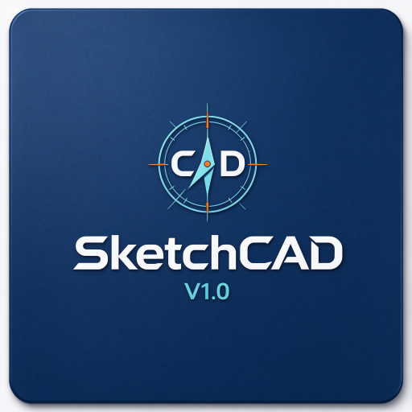
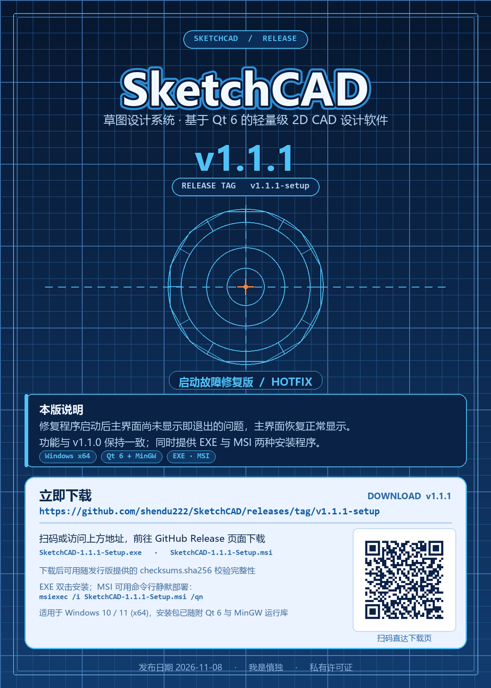
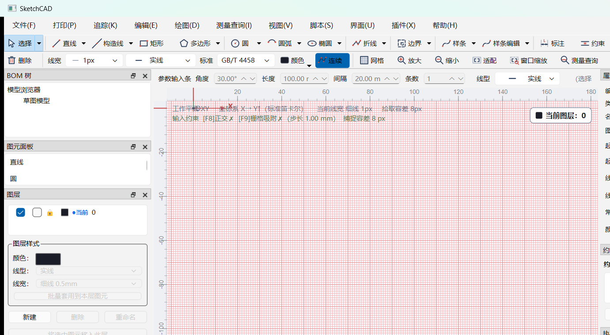
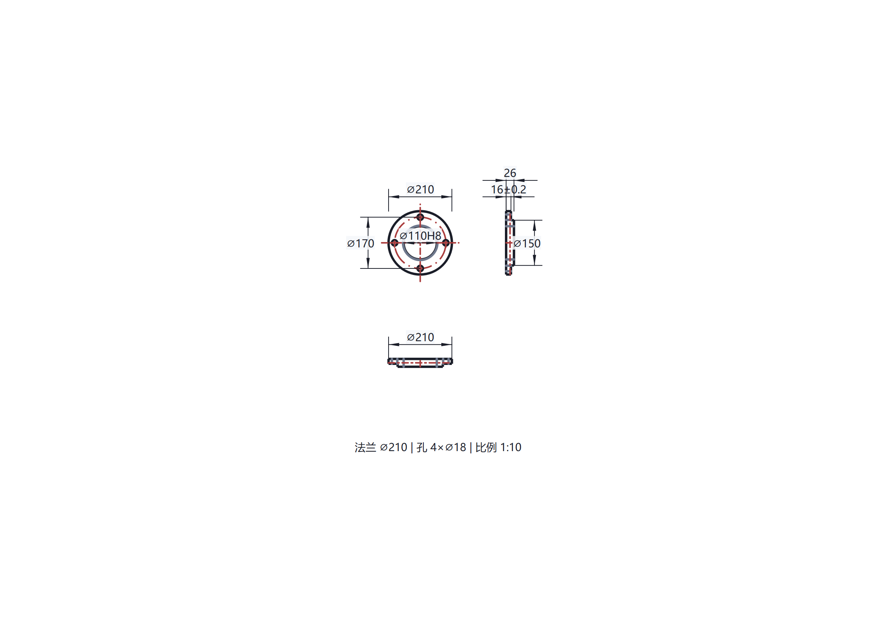
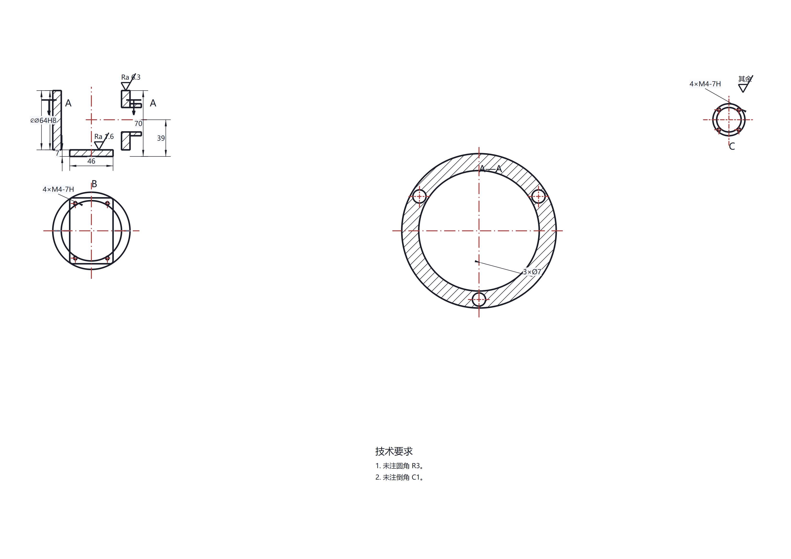
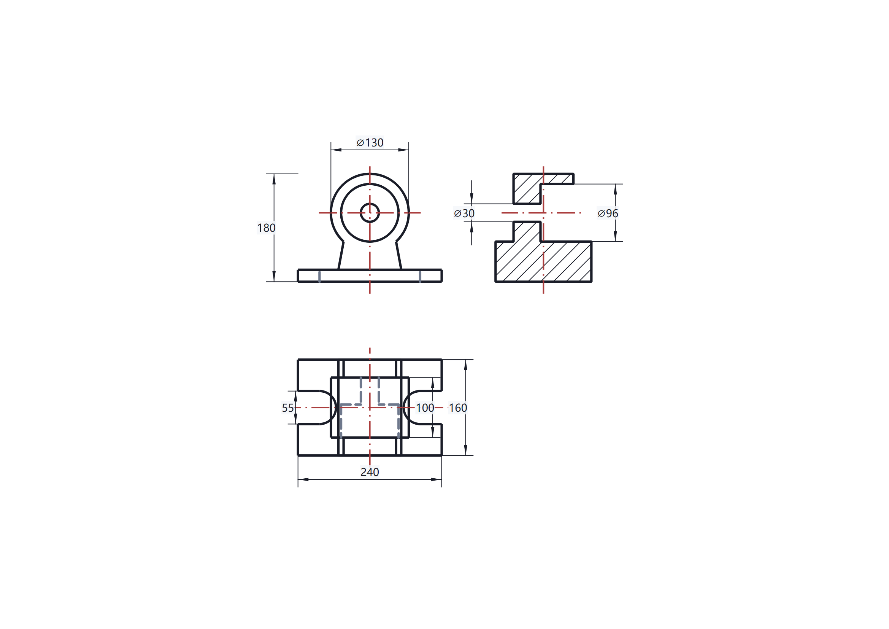
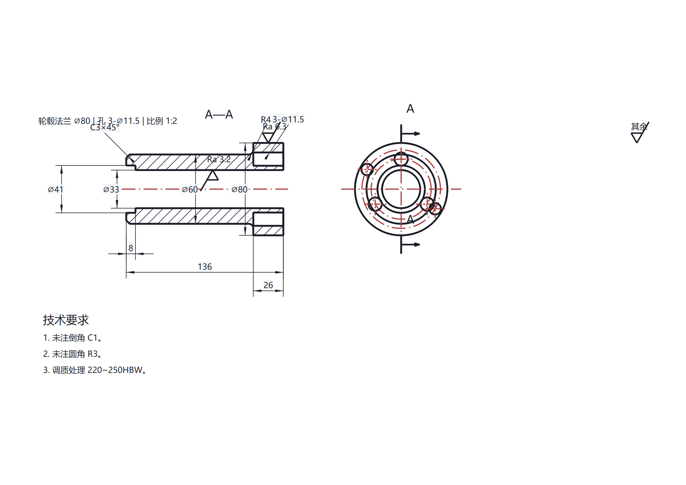
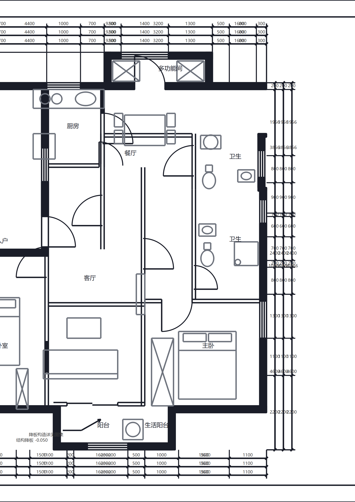
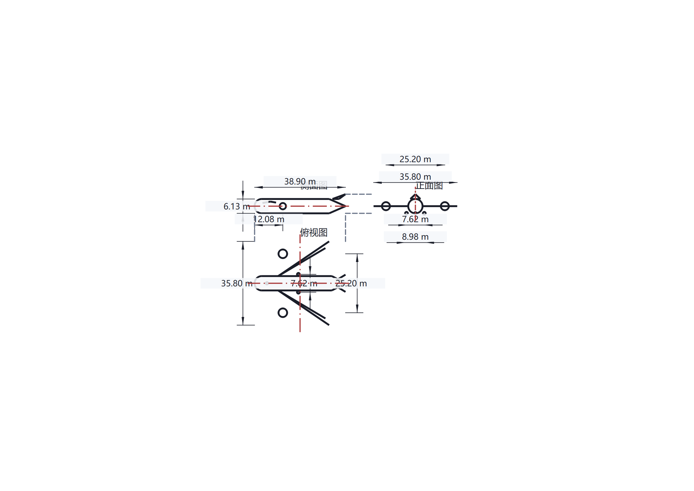
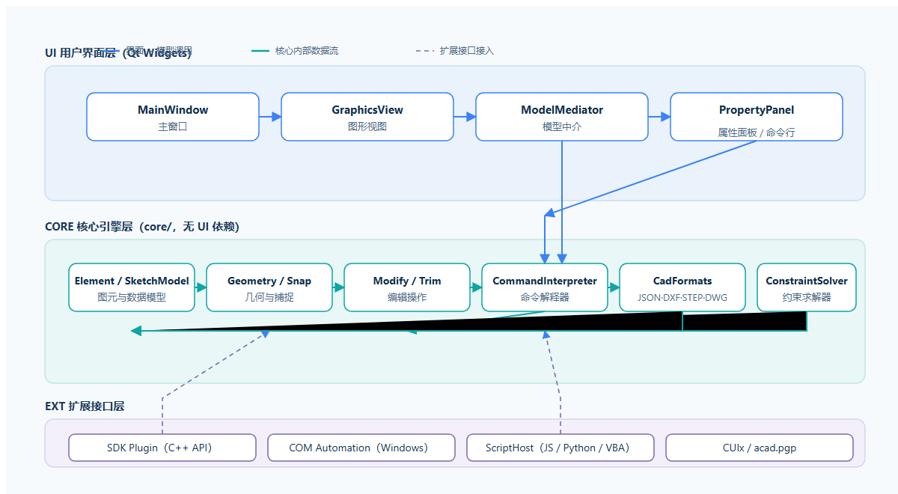

# SketchCAD

> [Chinese README](README.md) · **English**

<p align="center">
  
</p>

> **A lightweight 2D CAD application built on Qt 6** — C++17 · pure Qt Widgets · 60+ drawing commands · GB/T standards support

  

<p align="center">
  
</p>

> **v1.1.1 released** — startup hotfix: fixes the issue where the process exited before the main window appeared. Functionality is identical to v1.1.0. Both **EXE** (Inno Setup) and **MSI** (Windows Installer) installers are provided.
>
> **Download**: [https://github.com/shendu222/SketchCAD/releases/tag/v1.1.1-setup](https://github.com/shendu222/SketchCAD/releases/tag/v1.1.1-setup) · Full release notes: [RELEASE_NOTES.md](RELEASE_NOTES.md)

SketchCAD targets engineering drafting: standards-compliant lineweights, linetypes, drawing frames, dimensioning and section annotations, covering general mechanical and aerospace drafting workflows. Built-in **parametric drafting templates** for flanges, housings, bearings, sections and process three-view drawings generate a complete drawing sheet from a few parameters.

---

## ✨ Why SketchCAD

| Feature | Description |
| :--- | :--- |
| **Lightweight and native** | Pure Qt Widgets implementation with **no external geometry kernel** — DXF / STEP I/O, hatching and constraint solving are all in-house |
| **Standards first** | Lineweight groups, linetypes, drawing frames, dimensioning, sections and surface roughness follow the **GB/T series** (GB/T 4458 / GB/T 14665); one-click ISO switch |
| **Dual interaction modes** | Menus, toolbars and direct mouse drawing, plus a bottom **command line** for precise input such as `line 0,0 50,0` |
| **Parametric templates** | Flange, housing, bearing, flange-hub, section and process three-view templates generate views, sections, dimensions and title blocks from parameters |
| **Command ecosystem** | 60+ drawing and editing commands with ortho / grid snap / polar tracking / object snap / constraint solving |
| **Extensibility** | JavaScript scripting, macro recording, CUI aliases, SDK plugins (C++ API) and Windows COM automation |
| **Engineering self-verification** | 403 self-tests passing, zero-warning build, performance benchmarks and offscreen render comparison |

---

## 🖥️ UI Overview

<p align="center">
  
</p>

Classic CAD layout: top menus (File / Plot / Tracking / Edit / Draw / Measure && Inquiry / View / Script / Interface / Plugins / Help), **BOM tree + entity panel + layers** on the left, a drawing area with a coordinate grid on the right (F8 ortho, F9 grid snap, object snap), and a **parameter input bar** above for precise angle / length / spacing / count input.

---

## 📐 Core Features

### ✏️ Drawing Command Quick Reference

| Category | Common commands |
| :--- | :--- |
| **Basic entities** | `line`, `circle`, `arc`, `rect`, `poly`, `spline`, `ellipse`, `mtext` |
| **Editing** | `move`, `rotate`, `scale`, `mirror`, `offset`, `trim`, `fillet`, `chamfer` |
| **Array tools** | `join`, `arrayrect`, `arraypolar`, `arraypath` |
| **Inquiry & measure** | `dist`, `area`, `massprop`, `id`, `list` |
| **Selection filters** | `select_all`, `invert`, `select_layer`, `qselect` |
| **Dimensions & constraints** | `dim`, `dims`, `constraint`, `perp`, `tangent2`, `qconnect` |
| **Ortho & snapping** | `ortho`, `snap`, `dyn`, `polar`, `otrack`, `tk` |
| **Macros & general** | `macrorec`, `undo`, `redo`, `clear`, `help` |

### 🗂️ Dedicated Drafting Views (Parametric Templates)

| View | Description | Preview |
| :--- | :--- | :--- |
| **Flange plate view** `FlangeViews` | Sheet-metal development with GB standard-part parameters |  |
| **Housing view** `HousingViews` | Housing machining drawing + GB standard-part library |  |
| **Bearing view** `BearingViews` | Bearing selection calculations with a GB standard database |  |
| **Flange-hub view** `FlangeHubViews` | Parametric flange + hub design |  |
| **Section view** `FloorPlanViews` | Section plane definition with hatch support |  |
| **Process view** `AircraftViews` | Process route annotation and dimension-chain calculation |  |

### 💾 Data Format Support

| Format | Read / Write | Notes |
| :--- | :--- | :--- |
| **JSON** | ✅ / ✅ | Native internal format, organized as key/value pairs |
| **DXF** | ✅ / ✅ | AutoCAD DXF R12 compatible, including SPLINE |
| **STEP** | ✅ / ✅ | ISO 10303 exchange format |
| **DWG** | ✅ / ❌ | R12 read-only, CODEPAGE / AC1009 compatible |

### 🏗️ Architecture

<p align="center">
  
</p>

The UI layer (Qt Widgets) drives the core engine through `ModelMediator`; the `core/` engine has **no UI dependency** and owns the entity model, geometric snapping, editing operations, command interpretation, format I/O and constraint solving. SDK plugins, COM automation, the script host and CUI aliases attach to the core through extension interfaces.

The core data model is a unified list of entities (`Element`) covering 12 entity types: line, circle, arc, rectangle, polygon, spline, ellipse, polyline, text, dimension, section region and more.

---

## 🚀 Quick Start

### One-click Install

v1.1.1 ships two installers, both available on the [Release page](https://github.com/shendu222/SketchCAD/releases/tag/v1.1.1-setup) (or scan the QR code on the release poster above):

| Installer | Use case |
| :--- | :--- |
| `SketchCAD-1.1.1-Setup.exe` | Inno Setup wizard: license agreement, optional desktop icon and file associations |
| `SketchCAD-1.1.1-Setup.msi` | Windows Installer: silent `msiexec` deployment / Group Policy distribution |

Both are built from the same set of program files and are identical in content; verify integrity with the supplied `checksums.sha256` via `sha256sum -c`.

Double-click the EXE to install, or install silently from the command line:

```cmd
SketchCAD-1.1.1-Setup.exe /VERYSILENT /SUPPRESSMSGBOXES /NORESTART
msiexec /i SketchCAD-1.1.1-Setup.msi /qn
```

### First Use

1. **Launch** → choose drawing units (millimeters / inches)
2. **Draw a line** → type `line 0,0 50,0` in the command line, or use the toolbar
3. **Save** → JSON / DXF / STEP / DWG formats

### System Requirements

- **OS**: Windows 10 / 11 (x64)
- **Runtime**: the installer bundles the Qt 6 and MinGW runtimes; no separate MSVC runtime is required
- **Minimum**: 4 GB RAM, 200 MB disk space

---

## 🛠️ Build & Development

### Prerequisites

- **Qt 6.10.1 MinGW 64** + **MinGW-w64 GCC 13.1.0** (`mingw1310_64`)
- **CMake ≥ 3.16** + **Ninja**
- **Windows COM automation** → `windeployqt` deployment tool

### Build Commands

```bash
# Option 1: Git Bash script
./build.sh                    # compile -> build/SketchCAD.exe
./build.sh test               # run tests (403/0 passing)
./build.sh dist               # windeployqt packaging into dist/
./build.sh package            # EXE + MSI installers -> dist/SketchCAD-<version>-Setup.exe / .msi

# Option 2: direct CMake build
cmake -S . -B build -G Ninja -DCMAKE_BUILD_TYPE=Release
cmake --build build
./build/SketchCAD.exe
```

### Directory Layout

```
sketch-cad-cpp/
├── 📄 CMakeLists.txt          # Main build script (single source of version, includes bench/)
├── 📜 build.sh                # Build / test / package script (Git Bash)
├── 📁 src/
│   ├── main.cpp               # Application entry point
│   ├── core/                  # Core engine (no UI dependency)
│   │   ├── Element*.cpp + SketchModel.*    # Entities and data model
│   │   ├── LineModes... + Geometry + Snap  # Drawing modes and geometric snapping
│   │   ├── Modify + Trim + ConstraintSolver# Editing and constraint solving
│   │   ├── CommandInterpreter + CuiManager # Command parser and aliases
│   │   ├── CadFormats         # JSON / DXF / STEP / DWG support
│   │   └── FlangeViews...     # Dedicated parametric view system
│   ├── ui/
│   │   ├── MainWindow + GraphicsView       # Main window and graphics view
│   │   ├── tools/ + CommandLine            # Interactive tools and command line
│   │   └── PrintEngine + ScriptHost        # Print engine and script host
│   ├── tests/                 # SketchSelfTest (403 self-tests)
│   └── bench/                 # Performance benchmarks
├── 📚 docs/                   # Design docs, user manual and UI screenshots
├── 📦 dist/                   # windeployqt release directory
├── 🎨 resources/              # Icons, version info and brand assets
└── 🛠️ tools/                  # Helper tools (DXF import/export, etc.)
```

---

## 📖 Documentation

| Document | Summary |
| :--- | :--- |
| [User Manual](docs/用户手册.md) | Complete feature reference and operating guide for end users (the linked file keeps its original Chinese filename) |
| [Editing System](docs/batch-edit-join-array-clipboard-design-analysis.md) | Batch editing / array / clipboard design |
| [Polyline Editing](docs/polyline-edit-pedit-design-analysis.md) | Polyline editing (PEDIT) implementation details |
| [Grip Interaction](docs/grip-selection-design-analysis.md) | Grip selection / boundary regions / inquiry and measurement |
| [DXF Import Extensions](docs/dxf-import-expansion-design-analysis.md) | DXF import extensions and native DWG compatibility analysis |
| [Print Module](docs/print-module-design-analysis.md) | Print engine and plot fidelity |
| [SDK Plugins](docs/sdk-plugin-framework-design-analysis.md) | SDK plugin development guide (C++ API) |
| [Selection Filters](docs/selection-group-qselect-filter-design-analysis.md) | Selection groups / qselect filtering design |
| [Command Parity](docs/command-parity-design-analysis.md) | Alignment with mainstream CAD commands |
| [vs. AutoCAD](docs/cad-vs-autocad-gap-analysis-2026-10.md) | Feature gaps between SketchCAD and mainstream CAD, with a roadmap |

> More design analyses live in `docs/` (the `*-design-analysis.md` series covering snapping, constraints, dimensions, sections, layers, blocks, scripting, macros, CUI, COM, DXF/DWG, plotting, multi-document, undo and more).

---

## 📋 Command Reference

### Basic Syntax

```
command [args...]            # e.g. line 0,0 50,0
command_h [args...]          # the _h suffix usually means horizontal mode
```

### Common Examples

```bash
line 0,0 50,0              # draw a segment from (0,0) to (50,0)
circle_cr 20,20 10         # draw a circle centered at (20,20) with radius 10
arrayrect 3 4 20 15        # rectangular array: 3 columns x 4 rows, spacing 20x15
join                       # join adjacent entities
qselect type=直线 layer=0  # quick-select all lines on layer 0 (the type value is a command argument and must stay verbatim)
```

---

## ⚙️ Advanced Configuration

### Registry & Paths

| Path | Purpose |
| :--- | :--- |
| `%LOCALAPPDATA%\SketchCAD` | Autosave files, crash logs and runtime logs |
| `HKCU\Software\SketchCAD` | COM automation registration keys |

### Interface Language

Switch between `zh-CN` and `en` under Options > General > Interface Language. English mode covers menus, toolbars, the status bar, command-line feedback, dialogs, errors and empty-state hints. The dictionary and generator live in `tools/i18n/`; run `python tools/i18n/build_i18n.py --check` to verify translation coverage, or `--apply` to regenerate `src/core/I18nDict.cpp`. Chinese is the source language, so all text and behavior remain unchanged.

### Install / Uninstall Switches

```cmd
:: Silent install (EXE)
SketchCAD-1.1.1-Setup.exe /VERYSILENT /SUPPRESSMSGBOXES /NORESTART

:: Silent install (MSI)
msiexec /i SketchCAD-1.1.1-Setup.msi /qn

:: Silent uninstall (after EXE install, inside the program directory)
unins000.exe /VERYSILENT

:: Silent uninstall (after MSI install)
msiexec /x SketchCAD-1.1.1-Setup.msi /qn
```

---

## 🧪 Tests & Benchmarks

| Test type | Tool / Result | Notes |
| :--- | :--- | :--- |
| **Unit tests** | `SketchSelfTest` | **403 passing / 0 failing** (entities / editing / constraints / selection) |
| **GUI tests** | offscreen screenshots | HiDPI / multi-language / multi-resolution comparison |
| **Performance** | `SketchBenchmark` | single-threaded 44.5 ms / p99 0.011 ms |
| **Build quality** | `-Wall -Wextra` | **0 warnings** |

---

## 📜 License & Acknowledgements

This project uses a **proprietary license**; see [LICENSE.txt](LICENSE.txt).

- **Qt 6** (LGPL v3): core UI framework
- **libredwg** (GPL): DWG compatibility reading
- Thanks to every developer who contributed code and suggestions to SketchCAD!

---

## 🆘 FAQ

| Symptom | Suggested fix |
| :--- | :--- |
| **Exits before the main window appears** | Upgrade to **v1.1.1** (fixes the startup crash caused by dock-widget initialization order); see `RELEASE_NOTES.md` |
| **No response on startup** | Check that the Qt runtime path `C:\Qt\6.10.1` is configured correctly |
| **Drawing renders incorrectly** | Try disabling the `closed` / `hatch` display options and retry |
| **COM calls fail** | Make sure the installer has been run and the registry keys were written |

---

<p align="center">
  
</p>

<p align="center">
  <em>SketchCAD — making CAD design simpler · parametric · standardized</em>
</p>
