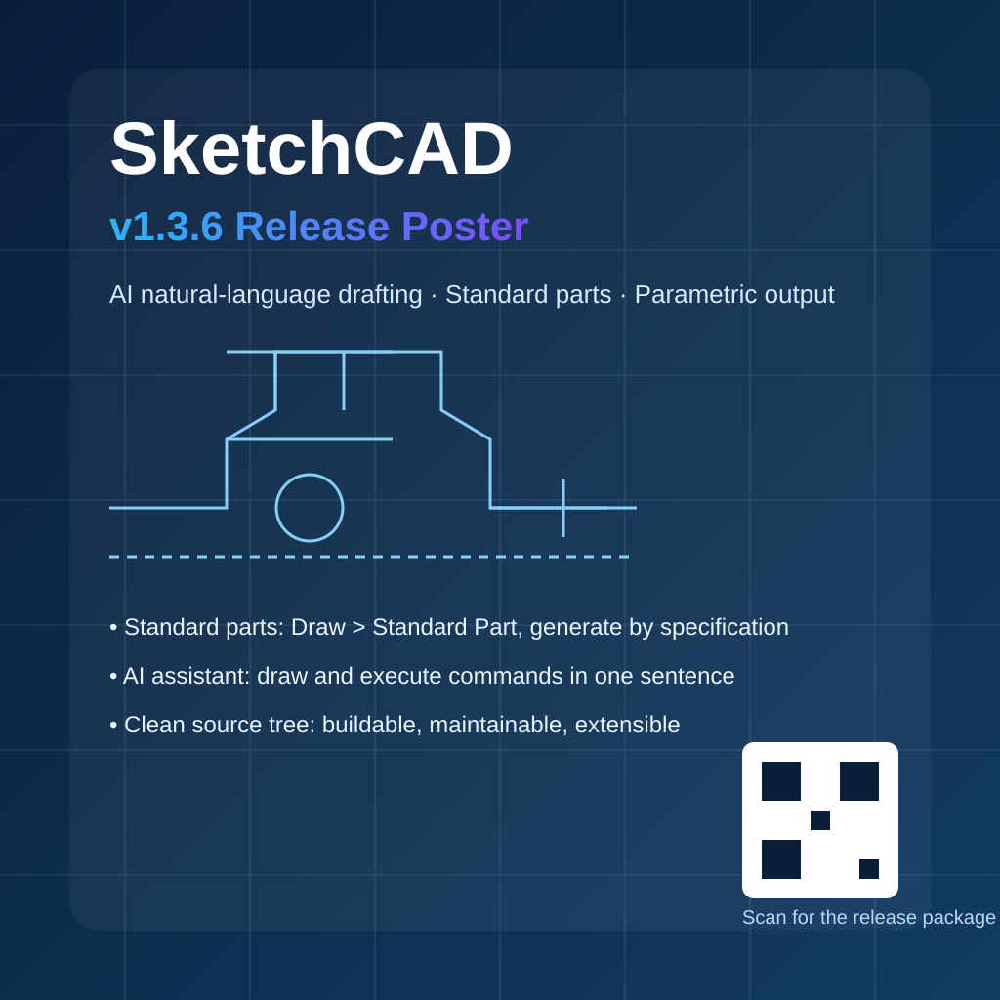
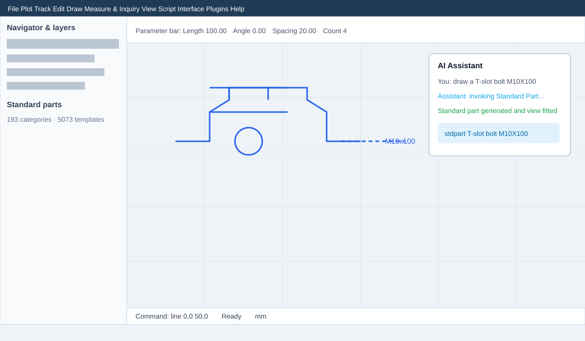
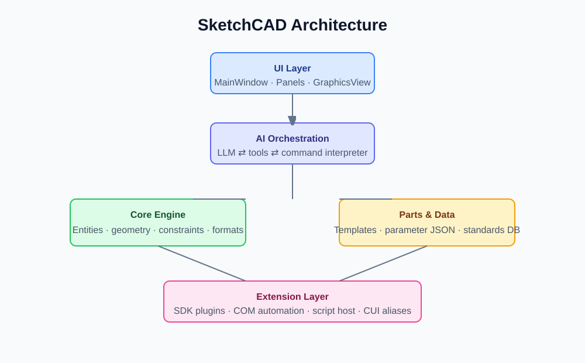
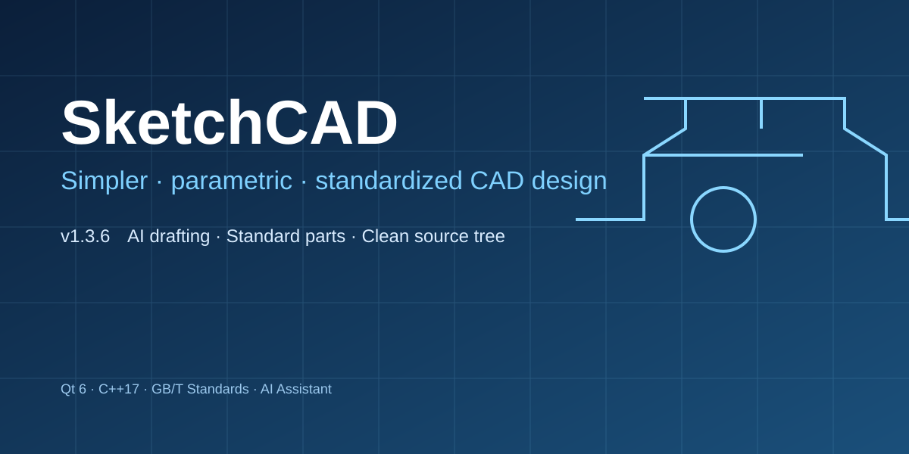

# SketchCAD

> [Chinese README](README.md) · **English**

<p align="center">
  
</p>

> **A lightweight 2D CAD application built on Qt 6** — C++17 · pure Qt Widgets · 220+ commands · standard-part library · AI natural-language drafting

  

<p align="center">
  
</p>

> **v1.3.6 released** — feature release: the AI assistant recognizes “draw a T-slot bolt M10X100” as the Draw > Standard Part function and generates the drawing. Tool calls, structured JSON commands and bare command lines all execute, and the view is fitted automatically afterward.
>
> **Download**: [GitHub Releases](https://github.com/shendu222/SketchCAD/releases) · Full release notes: [RELEASE_NOTES.md](RELEASE_NOTES.md)

SketchCAD targets engineering drafting: standards-compliant lineweights, linetypes, drawing frames, dimensioning and section annotations, covering general mechanical and aerospace drafting workflows. It ships with 193 categories, 5073 original DWG templates and 4792 specification points, ready for parametric, AI-driven or dialog-based part generation.

---

## ✨ Why SketchCAD

| Feature | Description |
| :--- | :--- |
| **Lightweight and native** | Pure Qt Widgets implementation with **no external geometry kernel** — DXF / STEP I/O, hatching and constraint solving are all in-house |
| **Standards first** | Lineweight groups, linetypes, drawing frames, dimensioning, sections and surface roughness follow the **GB/T series** (GB/T 4458 / GB/T 14665); one-click ISO switch |
| **Dual interaction modes** | Menus, toolbars and direct mouse drawing, plus a bottom **command line** for precise input such as `line 0,0 50,0` |
| **Command ecosystem** | 220+ drawing and editing commands with ortho / grid snap / polar tracking / object snap / constraint solving |
| **AI natural-language drafting** | Built-in AI assistant: tool calls, JSON commands and bare command lines are all executable. Standard-part requests are routed to the Standard Part entry, completing “understand → execute → draw → feedback” in one sentence |
| **Standard-part library** | 193 GB standard-part categories, 5073 original DWG templates and 4792 specification points; placeholder substitution, `.stdpart.json` instances, placement at a chosen point and reopen/re-render |
| **Extensibility** | JavaScript scripting, macro recording, CUI aliases, SDK plugins (C++ API) and Windows COM automation |
| **Engineering self-verification** | Zero-warning `-Wall -Wextra` build; offscreen startup and render smoke checks; a clean source tree containing only core code, configuration and runtime data |

---

## 🖥️ UI Overview

<p align="center">
  
</p>

Classic CAD layout: top menus (File / Plot / Tracking / Edit / Draw / Measure & Inquiry / View / Script / Interface / Plugins / Help), **BOM tree + entity panel + layers** on the left, a drawing area with a coordinate grid on the right (F8 ortho, F9 grid snap, object snap), and a **parameter input bar** above for precise angle / length / spacing / count input.

Draw > Standard Part opens the **Standard Part Library dialog**: category navigation, thumbnail preview, parameter configuration, instance workset and action buttons are collected in one non-modal window. The AI panel and command line share the same command interpreter, so every drawing action is undoable and traceable.

---

## 📐 Core Features

### ✏️ Drawing Command Quick Reference

| Category | Common commands |
| :--- | :--- |
| **Basic entities** | `line`, `circle`, `arc`, `rect`, `poly`, `spline`, `ellipse`, `mtext` |
| **Editing** | `move`, `rotate`, `scale`, `mirror`, `offset`, `trim`, `fillet`, `chamfer` |
| **Array tools** | `join`, `arrayrect`, `arraypolar`, `arraypath` |
| **Inquiry & measure** | `dist`, `area`, `massprop`, `id`, `list` |
| **Selection filters** | `select_all`, `invert`, `select_layer`, `qselect` |
| **Dimensions & constraints** | `dim`, `dims`, `constraint`, `perp`, `tangent2`, `qconnect` |
| **Standard parts** | `stdpart T-slot bolt M10X100`, `stdpart hex bolt M10x100` |
| **Ortho & snapping** | `ortho`, `snap`, `dyn`, `polar`, `otrack`, `tk` |
| **Macros & general** | `macrorec`, `undo`, `redo`, `clear`, `help` |

### 🤖 AI Assistant and Standard-Part Drafting

- **Natural language to commands**: the AI assistant calls `runSketchCommand`, converting a user description into the same command string used by menus and the command line.
- **All three return shapes execute**: standard function calling, structured JSON and a bare command line emitted as plain text (for example `stdpart M10X100`) are all executed.
- **Standard-part disambiguation**: when a standard-part name and a specification are present — bolt, T-slot bolt, nut, washer, pin, key, bearing, etc. — the request is routed to `stdpart` and never split into “T-slot + bolt” manual drafting steps.
- **Direct commands in the AI panel**: entering `stdpart M10X100` in the AI panel executes immediately instead of returning only a textual “done” message.
- **Closed execution loop**: successful commands are logged; standard-part drawing automatically fits the view so the result is immediately visible.
- **Persistent parameter instances**: `.stdpart.json` stores `formatVersion/schemaVersion`, `typeId`, `templateId`, `params` and `placement`; reopening re-renders from the same template.

### 💾 Data Format Support

| Format | Read / Write | Notes |
| :--- | :--- | :--- |
| **JSON** | ✅ / ✅ | Native internal format, organized as key/value pairs |
| **DXF** | ✅ / ✅ | AutoCAD DXF R12 compatible, including SPLINE |
| **STEP** | ✅ / ✅ | ISO 10303 exchange format |
| **DWG** | ✅ / ❌ | R12 read-only, CODEPAGE / AC1009 compatible |
| **`.stdpart.json`** | ✅ / ✅ | Standard-part instance: type ID, parameter values, version fields and placement |

### 🏗️ Architecture

<p align="center">
  
</p>

The UI layer (Qt Widgets) drives the core engine through `ModelMediator`; the AI orchestration layer turns natural language into commands through tools; the `core/` engine has **no UI dependency** and owns the entity model, geometric snapping, editing operations, command interpretation, format I/O, standard-part templates and constraint solving. SDK plugins, COM automation, the script host and CUI aliases attach to the core through extension interfaces.

The core data model is a unified list of entities (`Element`) covering 12 entity types: line, circle, arc, rectangle, polygon, spline, ellipse, polyline, text, dimension, section region and more.

---

## 🚀 Quick Start

### One-click Install

v1.3.6 ships EXE and MSI installers, both available on the [Release page](https://github.com/shendu222/SketchCAD/releases) (or scan the QR code on the release poster above):

| Installer | Use case |
| :--- | :--- |
| `SketchCAD-1.3.6-Setup.exe` | Inno Setup wizard: license agreement, optional desktop icon and file associations |
| `SketchCAD-1.3.6-Setup.msi` | Windows Installer: silent `msiexec` deployment / Group Policy distribution |

Both are built from the same set of program files and are identical in content; verify integrity with the supplied `checksums.sha256` via `sha256sum -c`.

Double-click the EXE to install, or install silently from the command line:

```cmd
SketchCAD-1.3.6-Setup.exe /VERYSILENT /SUPPRESSMSGBOXES /NORESTART
msiexec /i SketchCAD-1.3.6-Setup.msi /qn
```

### First Use

1. **Launch** → choose drawing units (millimeters / inches)
2. **Draw a line** → type `line 0,0 50,0` in the command line, or use the toolbar
3. **Use AI** → type “draw a T-slot bolt M10X100” in the AI assistant
4. **Open the standard-part library** → Draw > Standard Part: choose a category, fill parameters, insert into the drawing or export `.stdpart.json`
5. **Save** → JSON / DXF / STEP formats

### System Requirements

- **OS**: Windows 10 / 11 (x64)
- **Runtime**: the installer bundles the Qt 6 and MinGW runtimes; no separate MSVC runtime is required
- **Minimum**: 4 GB RAM, 200 MB disk space

---

## 🛠️ Build & Development

### Prerequisites

- **Qt 6.10.1 MinGW 64** + **MinGW-w64 GCC 13.1.0** (`mingw1310_64`)
- **CMake ≥ 3.16** + **Ninja**
- **Windows COM automation** → `windeployqt` deployment tool

### Build Commands

```bash
# Option 1: Git Bash script
./build.sh                    # compile -> build/SketchCAD.exe
./build.sh dist               # windeployqt packaging into dist/
./build.sh package            # EXE + MSI installers -> dist/SketchCAD-<version>-Setup.exe / .msi

# Option 2: direct CMake build
cmake -S . -B build -G Ninja -DCMAKE_BUILD_TYPE=Release
cmake --build build
./build/SketchCAD.exe
```

### Directory Layout

```
sketch-cad-cpp/
├── 📄 CMakeLists.txt          # Main build script (single source of version)
├── 📜 build.sh                # Build / package script (Git Bash)
├── ⚙️ config/                  # Command catalog and runtime configuration
├── 📁 src/
│   ├── main.cpp               # Application entry point
│   ├── core/                  # Core engine (no UI dependency)
│   │   ├── Element*.cpp + SketchModel.*    # Entities and data model
│   │   ├── LineModes... + Geometry + Snap  # Drawing modes and geometric snapping
│   │   ├── Modify + Trim + ConstraintSolver# Editing and constraint solving
│   │   ├── CommandInterpreter + Commands   # Interpreter and stdpart command
│   │   ├── StdPartTemplate/StdPartInstance # Template library and parameter JSON
│   │   └── CadFormats         # JSON / DXF / STEP / DWG support
│   └── ui/
│       ├── MainWindow + GraphicsView       # Main window and graphics view
│       ├── StdPartTemplateDialog + Panel   # Draw > Standard Part dialog and panel
│       ├── AiAssistantPanel + CommandLine  # AI panel and command line
│       └── tools/ + PrintEngine            # Interactive tools and printing
├── 📚 RELEASE_NOTES.md         # Version history and fix notes
├── 📦 packaging/               # Inno Setup / WiX installer configuration
├── 🎨 resources/               # Icons, images, version info and brand assets
│   └── i18n/{zh,en}/           # Localized README images
└── 🧩 data/stdpart/            # Standard-part template library and runtime index
```

---

## 📖 Documentation

| Document | Summary |
| :--- | :--- |
| `docs/用户手册.md` | Complete feature reference and operating guide for end users (release documentation; not bundled in the clean source tree) |
| [Release Notes](RELEASE_NOTES.md) | Added features, fixes and verification for each version |
| [AI Orchestration](src/ai/NlAssistant.cpp) | LLM ⇄ tools ⇄ interpreter ⇄ model update loop |
| [AI Command Routing](config/command_catalog.json) | Names, purposes, parameters and examples of AI-callable commands |
| [Standard-Part Template Engine](src/core/StdPartTemplate.cpp) | DWG templates, placeholder substitution, length-zone scaling and placement |
| [Standard-Part Command](src/core/Commands.cpp) | `stdpart`: the core entry from natural-language requests to finished drawings |
| [Command Interpreter](src/core/CommandInterpreter.cpp) | Command registration, aliases, completion and execution |
| [Format I/O](src/core/CadFormats.cpp) | JSON / DXF / STEP / DWG implementation |
| [Print Module](src/ui/PrintEngine.cpp) | Print engine and plot fidelity |
| [SDK Interface](sdk/include/SketchCAD/i_plugin.h) | C++ plugin ABI and extension interface |

> The source tree stays lean: test programs, test data, design documents and build intermediates are not bundled with the main project. For historical design material, use release documentation or version control history.

---

## 📋 Command Reference

### Basic Syntax

```
command [args...]            # e.g. line 0,0 50,0
command_h [args...]          # the _h suffix usually means horizontal mode
```

### Common Examples

```bash
line 0,0 50,0              # draw a segment from (0,0) to (50,0)
circle_cr 20,20 10         # draw a circle centered at (20,20) with radius 10
arrayrect 3 4 20 15        # rectangular array: 3 columns x 4 rows, spacing 20x15
join                       # join adjacent entities
stdpart T-slot bolt M10X100 # generate a T-slot bolt directly
qselect type=直线 layer=0  # quick-select all lines on layer 0 (the type value is a command argument and must stay verbatim)
```

---

## ⚙️ Advanced Configuration

### Registry & Paths

| Path | Purpose |
| :--- | :--- |
| `%LOCALAPPDATA%\SketchCAD` | Autosave files, crash logs and runtime logs |
| `HKCU\Software\SketchCAD` | COM automation registration keys |

### Interface Language

Switch between `zh-CN` and `en` under Options > General > Interface Language. English mode covers menus, toolbars, the status bar, command-line feedback, dialogs, errors and empty-state hints. The dictionary is compiled into `src/core/I18nDict.cpp` and loaded at runtime; no separate generator is required. Chinese is the source language, so all text and behavior remain unchanged.

The README itself has Chinese and English versions, and every image has a matching file under `resources/i18n/zh/` and `resources/i18n/en/`; each README references only its own language directory.

### Install / Uninstall Switches

```cmd
:: Silent install (EXE)
SketchCAD-1.3.6-Setup.exe /VERYSILENT /SUPPRESSMSGBOXES /NORESTART

:: Silent install (MSI)
msiexec /i SketchCAD-1.3.6-Setup.msi /qn

:: Silent uninstall (after EXE install, inside the program directory)
unins000.exe /VERYSILENT

:: Silent uninstall (after MSI install)
msiexec /x SketchCAD-1.3.6-Setup.msi /qn
```

---

## 🧪 Tests & Benchmarks

| Test type | Tool / Result | Notes |
| :--- | :--- | :--- |
| **Build verification** | CMake + Ninja | Clean source tree configures and builds `SketchCAD` successfully |
| **Build quality** | `-Wall -Wextra` | **0 warnings** |
| **Offscreen smoke** | offscreen startup | Main window stays alive with no startup crash |
| **AI drawing verification** | command-path regression | `stdpart` tool calls / bare commands / direct AI-panel input all produce 180 entities and fit the view |

> The cleaned source tree no longer bundles test programs, test data or result files; verification relies on the build chain, offscreen startup and command-path regression.

---

## 📜 License & Acknowledgements

This project uses a **proprietary license**; see [LICENSE.txt](LICENSE.txt).

- **Qt 6** (LGPL v3): core UI framework
- **libredwg** (GPL): DWG compatibility reading
- Thanks to every developer who contributed code and suggestions to SketchCAD!

---

## 🆘 FAQ

| Symptom | Suggested fix |
| :--- | :--- |
| **AI only prints a command string but nothing is drawn** | Make sure you are running **v1.3.6** or newer; older builds do not execute bare command lines emitted by the model. Rebuild and restart: tool calls, JSON commands and bare commands all execute and fit the view. |
| **AI splits a standard part into manual drafting steps** | Upgrade to **v1.3.6**; a standard-part name plus specification is always routed to `stdpart`, matching Draw > Standard Part. |
| **No response on startup** | Check that the Qt runtime path `C:\Qt\6.10.1` is configured correctly |
| **Drawing renders incorrectly** | Try disabling the `closed` / `hatch` display options and retry |
| **COM calls fail** | Make sure the installer has been run and the registry keys were written |

---

<p align="center">
  
</p>

<p align="center">
  <em>SketchCAD — making CAD design simpler · parametric · standardized · intelligent</em>
</p>
