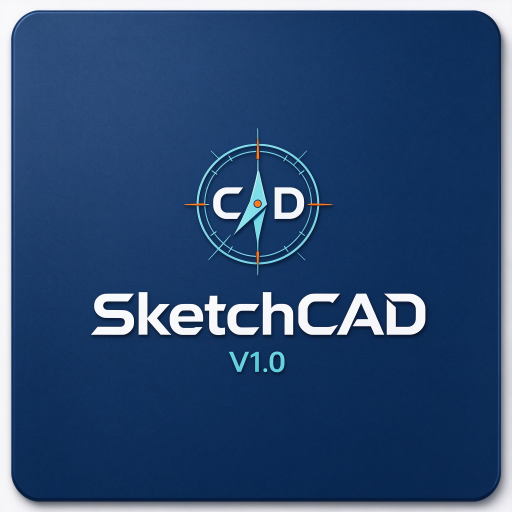
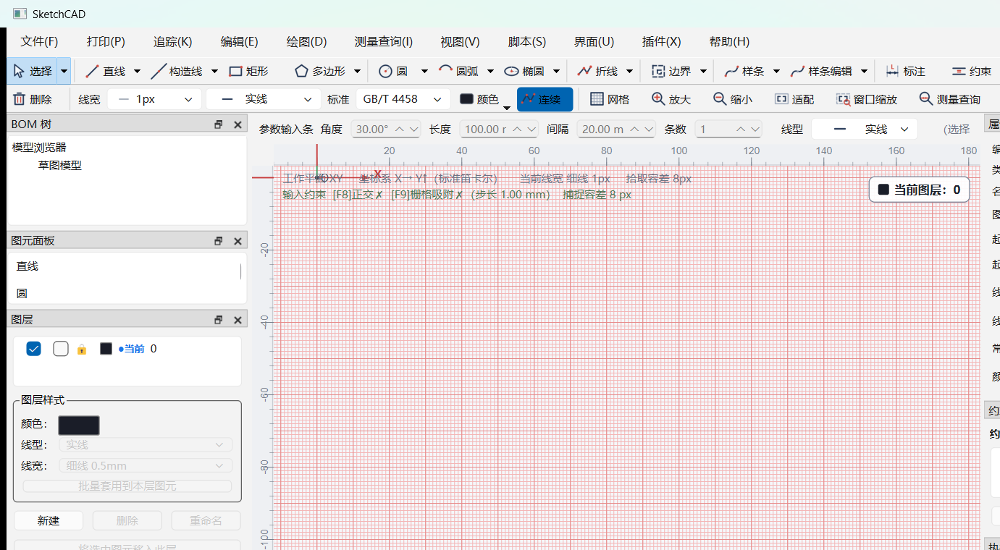
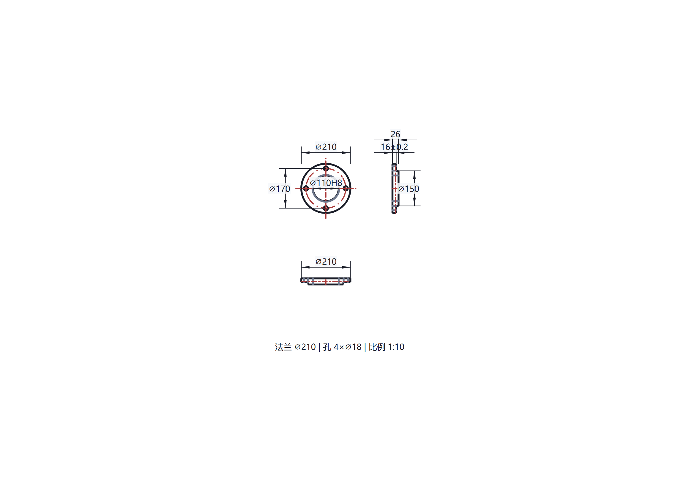
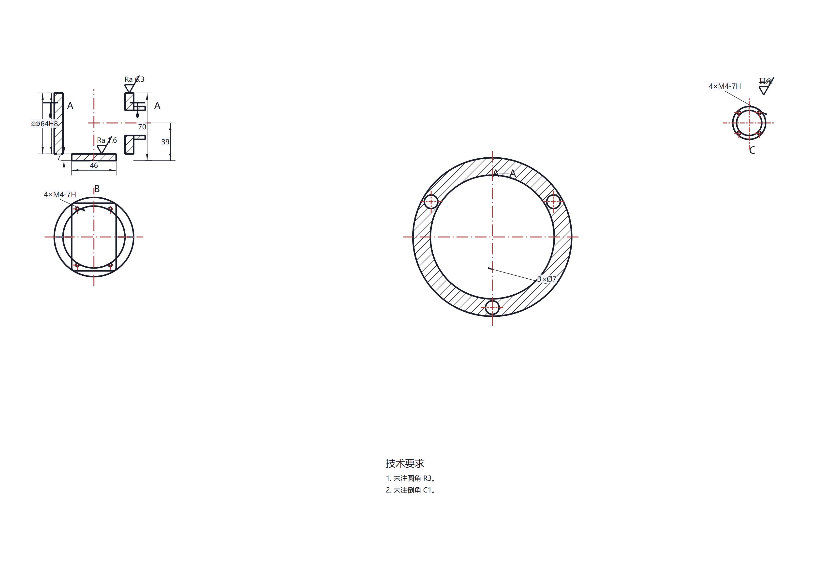
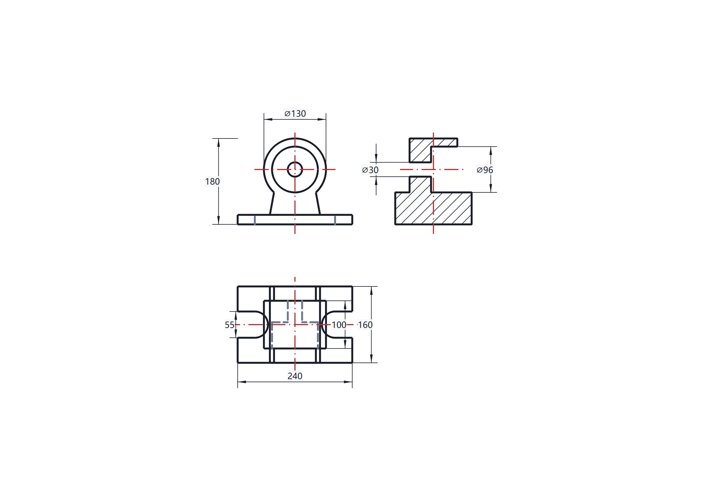
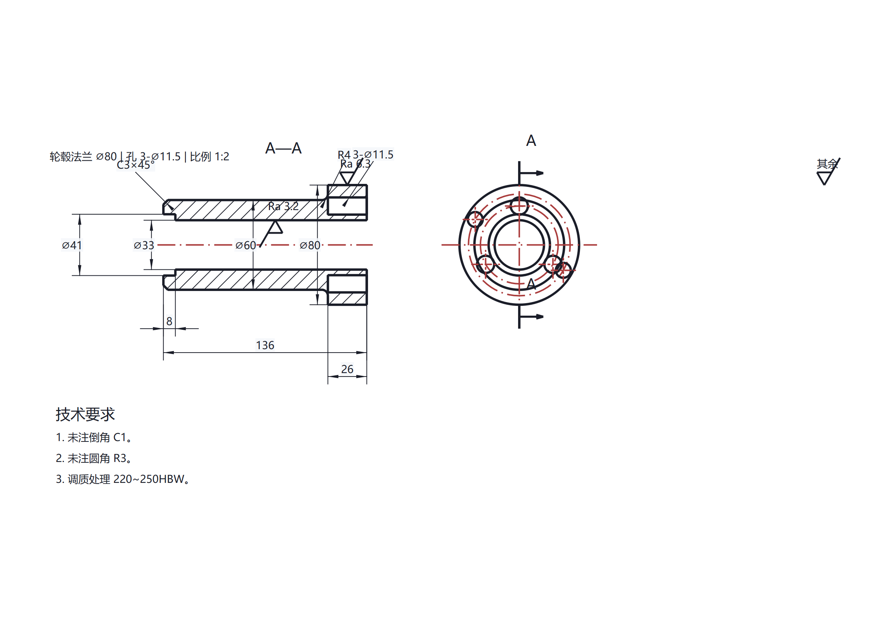
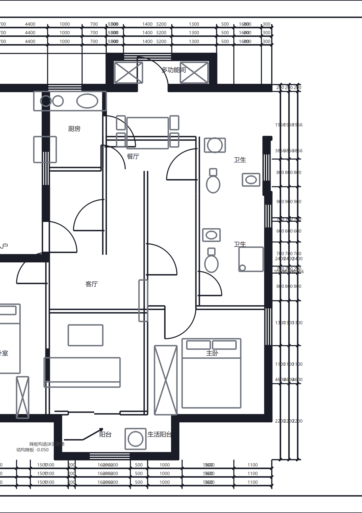
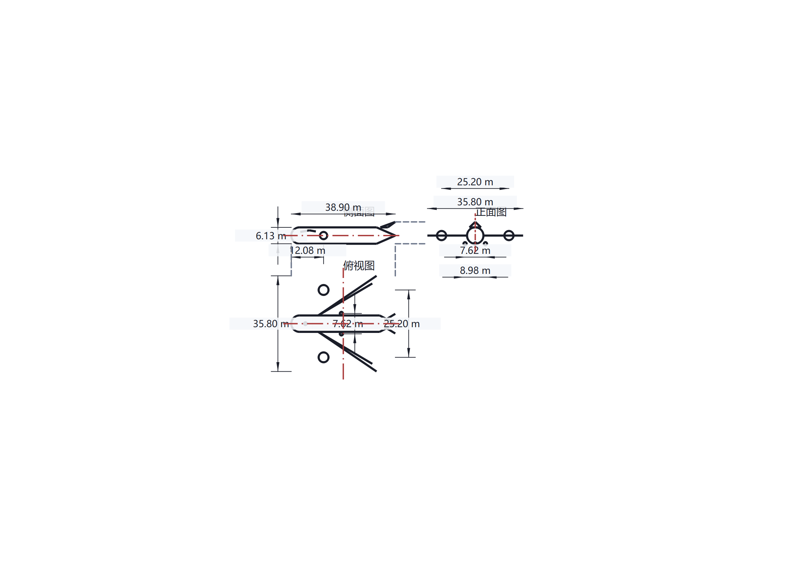
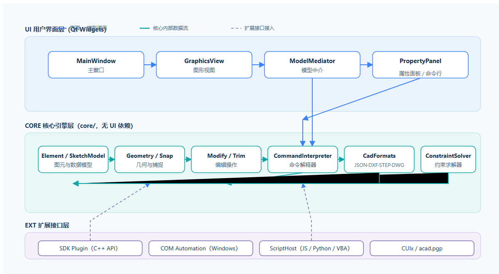
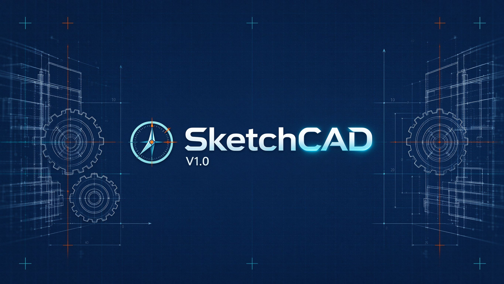

# SketchCAD

<p align="center">
  
</p>

> **一款基于 Qt 6 的轻量级 2D CAD 设计软件** —— C++17 · 纯 Qt Widgets · 60+ 绘图命令 · GB/T 国标支持

  

SketchCAD 面向工程制图场景：支持符合国标的线宽、线型、图框、尺寸注法与剖面标注，覆盖通用机械与航空制图流程；内置法兰、箱体、轴承、剖切、工艺三视图等**参数化制图模板**，输入参数即可自动生成成套图面。

---

## ✨ 为什么选择 SketchCAD

| 特性 | 说明 |
| :--- | :--- |
| **轻量原生** | 纯 Qt Widgets 实现，**零外部几何库**——DXF / STEP 读写、剖面填充、约束求解均为自研 |
| **国标优先** | 线宽组别、线型、图框、尺寸注法、剖面、粗糙度遵循 **GB/T 系列标准**（GB/T 4458 / GB/T 14665），支持一键切换 ISO |
| **双模式交互** | 菜单、工具栏、鼠标直接绘制；同时支持底部**命令行**精确输入，如 `line 0,0 50,0` |
| **参数化模板** | 法兰盘、箱体、轴承、法兰毂、剖切、工艺三视图等模板，给定参数自动生成三视图、剖面、标注与图签 |
| **命令生态** | 60+ 绘图与编辑命令，支持正交 / 栅格吸附 / 极轴追踪 / 对象捕捉 / 约束求解 |
| **扩展能力** | JavaScript 脚本、宏录制、CUI 别名、SDK 插件（C++ API）与 Windows COM 自动化 |
| **工程自证** | 403 项自测全部通过，0 警告编译，含性能基准与离屏渲染比对 |

---

## 🖥️ 界面总览

<p align="center">
  
</p>

经典 CAD 布局：顶部菜单（文件 / 打印 / 追踪 / 编辑 / 绘图 / 测量查询 / 视图 / 脚本 / 界面 / 插件 / 帮助），左侧 **BOM 树 + 图元面板 + 图层**，右侧绘图区带坐标网格（F8 正交、F9 栅格吸附、对象捕捉），上方**参数输入条**支持角度 / 长度 / 间隔 / 条数精确输入。

---

## 📐 核心特性

### ✏️ 绘图命令速查

| 分类 | 常用命令示例 |
| :--- | :--- |
| **基础图元** | `line`, `circle`, `arc`, `rect`, `poly`, `spline`, `ellipse`, `mtext` |
| **编辑操作** | `move`, `rotate`, `scale`, `mirror`, `offset`, `trim`, `fillet`, `chamfer` |
| **阵列工具** | `join`, `arrayrect`, `arraypolar`, `arraypath` |
| **查询测量** | `dist`, `area`, `massprop`, `id`, `list` |
| **选择过滤** | `select_all`, `invert`, `select_layer`, `qselect` |
| **标注约束** | `dim`, `dims`, `constraint`, `perp`, `tangent2`, `qconnect` |
| **正交捕捉** | `ortho`, `snap`, `dyn`, `polar`, `otrack`, `tk` |
| **宏与通用** | `macrorec`, `undo`, `redo`, `clear`, `help` |

### 🗂️ 专用制图视图（参数化模板）

| 视图 | 说明 | 效果预览 |
| :--- | :--- | :--- |
| **旗板视图** `FlangeViews` | 钣金展开图，支持 GB 标准件参数化 |  |
| **箱体视图** `HousingViews` | 箱体加工图 + GB 标准件图库 |  |
| **轴承视图** `BearingViews` | 轴承选型计算，含 GB 标准数据库 |  |
| **法兰毂视图** `FlangeHubViews` | 法兰 + 毂参数化设计 |  |
| **剖切视图** `FloorPlanViews` | 剖切平面定义，支持剖面线填充 |  |
| **工艺视图** `AircraftViews` | 工艺路线标注与尺寸链计算 |  |

### 💾 数据格式支持

| 格式 | 读 / 写 | 说明 |
| :--- | :--- | :--- |
| **JSON** | ✅ / ✅ | 内部原生格式，按键值对组织 |
| **DXF** | ✅ / ✅ | AutoCAD DXF R12 兼容，支持 SPLINE 等 |
| **STEP** | ✅ / ✅ | ISO 10303 标准交换格式 |
| **DWG** | ✅ / ❌ | R12 只读，CODEPAGE / AC1009 兼容 |

### 🏗️ 架构设计

<p align="center">
  
</p>

UI 用户界面层（Qt Widgets）经 `ModelMediator` 驱动核心引擎；`core/` 核心引擎层**无 UI 依赖**，统一管理图元模型、几何捕捉、编辑操作、命令解释、格式读写与约束求解；SDK 插件、COM 自动化、脚本宿主与 CUI 别名通过扩展接口接入核心。

核心数据模型为统一的图元（`Element`）列表，覆盖直线、圆、圆弧、矩形、多边形、样条、椭圆、折线、文本、尺寸标注、剖面区域等 12 类图元。

---

## 🚀 快速开始

### 一键安装

下载最新安装包后双击运行，或通过命令行静默安装：

```cmd
SketchCAD-<version>-Setup.exe /VERYSILENT /SUPPRESSMSGBOXES /NORESTART
```

### 首次使用

1. **启动软件** → 选择绘图单位（毫米 / 英寸）
2. **绘制线条** → 命令行输入 `line 0,0 50,0` 或点击工具栏
3. **保存文件** → 支持 JSON / DXF / STEP / DWG 格式

### 环境要求

- **操作系统**: Windows 10 / 11 (x64)
- **运行库**: MSVC 2022 Runtime
- **最低配置**: 4GB RAM, 200MB 磁盘空间

---

## 🛠️ 构建与开发

### 环境准备

- **Qt 6.10.1 MinGW 64** + **MinGW-w64 GCC 13.1.0** (`mingw1310_64`)
- **CMake ≥ 3.16** + **Ninja**
- **Windows COM 自动化** → `windeployqt` 部署工具

### 构建命令

```bash
# 方式 1：Git Bash 脚本
./build.sh                    # 编译 → build/SketchCAD.exe
./build.sh test               # 运行测试 (403/0 通过)
./build.sh dist               # 打包 windeployqt 到 dist/
./build.sh package            # 生成安装包 → dist/SketchCAD-<version>-Setup.exe

# 方式 2：CMake 直接构建
cmake -S . -B build -G Ninja -DCMAKE_BUILD_TYPE=Release
cmake --build build
./build/SketchCAD.exe
```

### 目录结构

```
sketch-cad-cpp/
├── 📄 CMakeLists.txt          # 主构建脚本（版本号唯一来源，含 bench 子目录）
├── 📜 build.sh                # 构建 / 测试 / 打包脚本（Git Bash）
├── 📁 src/
│   ├── main.cpp               # 程序入口
│   ├── core/                  # 核心引擎（无 UI 依赖）
│   │   ├── Element*.cpp + SketchModel.*    # 图元与数据模型
│   │   ├── LineModes... + Geometry + Snap  # 绘图模式与几何捕捉
│   │   ├── Modify + Trim + ConstraintSolver# 编辑与约束求解
│   │   ├── CommandInterpreter + CuiManager # 命令解析器与别名
│   │   ├── CadFormats         # JSON / DXF / STEP / DWG 格式支持
│   │   └── FlangeViews...     # 专用参数化视图系统
│   ├── ui/
│   │   ├── MainWindow + GraphicsView       # 主界面与图形视图
│   │   ├── tools/ + CommandLine            # 交互工具与命令行
│   │   └── PrintEngine + ScriptHost        # 打印引擎与脚本宿主
│   ├── tests/                 # SketchSelfTest（403 项自测）
│   └── bench/                 # 性能基准测试
├── 📚 docs/                   # 设计文档、用户手册与界面截图
├── 📦 dist/                   # windeployqt 发布目录
├── 🎨 resources/              # 图标、版本信息与品牌视觉资源
└── 🛠️ tools/                  # 辅助工具（DXF 导入导出等）
```

---

## 📖 详细文档

| 文档 | 内容概要 |
| :--- | :--- |
| [用户手册](docs/用户手册.md) | 面向使用者的完整功能说明与操作指南 |
| [编辑系统](docs/batch-edit-join-array-clipboard-design-analysis.md) | 批量编辑 / 阵列 / 剪贴板设计 |
| [多段线编辑](docs/polyline-edit-pedit-design-analysis.md) | 多段线编辑（PEDIT）实现细节 |
| [夹点交互](docs/grip-selection-design-analysis.md) | 夹点选择 / 边界区域 / 查询测量 |
| [DXF 导入扩展](docs/dxf-import-expansion-design-analysis.md) | DXF 导入扩展与 DWG 原生兼容分析 |
| [打印模块](docs/print-module-design-analysis.md) | 打印引擎与打印保真实现 |
| [SDK 插件](docs/sdk-plugin-framework-design-analysis.md) | SDK 插件开发指南（C++ API） |
| [选择过滤](docs/selection-group-qselect-filter-design-analysis.md) | 选择组 / qselect 过滤设计 |
| [命令对齐](docs/command-parity-design-analysis.md) | 主流 CAD 命令对齐分析 |
| [与 AutoCAD 差异](docs/cad-vs-autocad-gap-analysis-2026-10.md) | SketchCAD 与主流 CAD 功能差异与改进路线 |

> 更多设计分析文档见 `docs/` 目录（`*-design-analysis.md` 系列，覆盖捕捉、约束、标注、剖面、图层、块、脚本、宏、CUI、COM、DXF/DWG、打印、多文档、撤销等主题）。

---

## 📋 命令参考

### 基础语法

```
命令名 [参数...]         # 例如: line 0,0 50,0
命令名_h [参数...]       # _h 后缀通常表示水平 (Horizontal) 模式
```

### 常用示例

```bash
line 0,0 50,0              # 绘制从 (0,0) 到 (50,0) 的线段
circle_cr 20,20 10         # 绘制圆心 (20,20) 半径 10 的圆
arrayrect 3 4 20 15        # 创建 3 列 4 行，间距 20x15 的矩形阵列
join                       # 合并相邻图元
qselect type=直线 layer=0  # 快速选择 0 层的所有直线
```

---

## ⚙️ 高级配置

### 注册表与路径

| 路径 | 说明 |
| :--- | :--- |
| `%LOCALAPPDATA%\SketchCAD` | 存放自动保存、崩溃日志、运行日志 |
| `HKCU\Software\SketchCAD` | COM 自动化注册项 |

### 安装 / 卸载参数

```cmd
:: 静默安装
SketchCAD-<version>-Setup.exe /VERYSILENT /SUPPRESSMSGBOXES /NORESTART

:: 静默卸载
SketchCAD-<version>-Setup.exe /VERYSILENT
```

---

## 🧪 测试与基准

| 测试类型 | 工具 / 结果 | 说明 |
| :--- | :--- | :--- |
| **单元测试** | `SketchSelfTest` | **403 项通过 / 0 失败**（覆盖图元 / 编辑 / 约束 / 选择） |
| **GUI 测试** | offscreen 截图 | 支持高分屏 / 多语言 / 多分辨率比对 |
| **性能基准** | `SketchBenchmark` | 单线程 44.5ms / p99 0.011ms |
| **编译质量** | `-Wall -Wextra` | **0 警告** |

---

## 📜 许可证与致谢

本项目采用**私有许可证**，详见 [LICENSE.txt](LICENSE.txt)。

- **Qt 6** (LGPL v3)：核心 UI 框架
- **libredwg** (GPL)：用于 DWG 文件兼容读取
- 感谢所有为 SketchCAD 贡献代码和建议的开发者！

---

## 🆘 常见问题 (FAQ)

| 问题现象 | 建议解决方案 |
| :--- | :--- |
| **启动无响应** | 检查 Qt 运行环境路径 `C:\Qt\6.10.1` 是否正确配置 |
| **绘图显示异常** | 尝试关闭 `closed` / `hatch` 相关显示选项后重试 |
| **COM 调用失败** | 确认已运行安装程序，注册表项已正确写入 |

---

<p align="center">
  
</p>

<p align="center">
  <em>SketchCAD —— 让 CAD 设计更简单 · 参数化 · 标准化</em>
</p>
