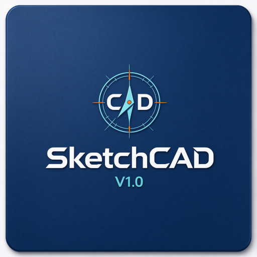
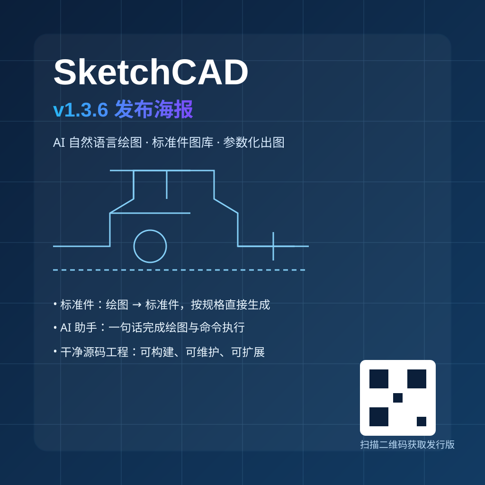
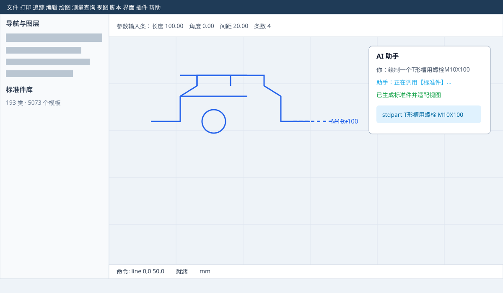
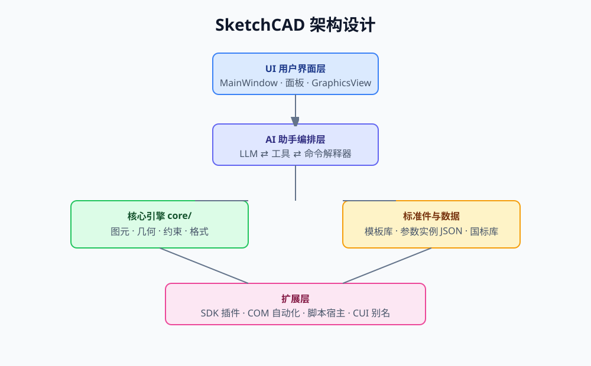
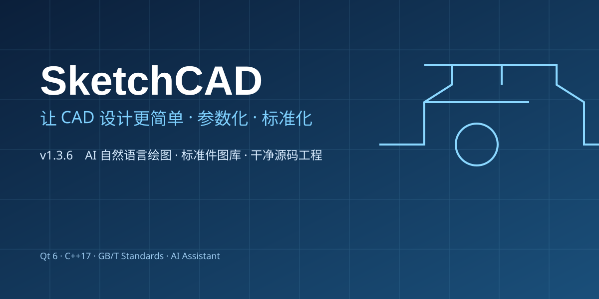

# SketchCAD

> 中文 · [English README](README.en.md)

<p align="center">
  
</p>

> **一款基于 Qt 6 的轻量级 2D CAD 设计软件** —— C++17 · 纯 Qt Widgets · 220+ 命令 · 标准件图库 · AI 自然语言绘图

  

<p align="center">
  
</p>

> **v1.3.6 已发布** —— 功能版：AI 助手可把“绘制一个T形槽用螺栓M10X100”直接识别为【绘图】-【标准件】并生成图形；命令行文本、结构化命令与工具调用三条路径均可执行，执行后自动适配视图。
>
> **下载地址**：[GitHub Releases](https://github.com/shendu222/SketchCAD/releases) · 完整发布说明见 [RELEASE_NOTES.md](RELEASE_NOTES.md)

SketchCAD 面向工程制图场景：支持符合国标的线宽、线型、图框、尺寸注法与剖面标注，覆盖通用机械与航空制图流程。内置 193 类、5073 个标准件原图模板与 4792 个规格点，可通过参数、AI 指令或【绘图】-【标准件】对话框直接出图。

---

## ✨ 为什么选择 SketchCAD

| 特性 | 说明 |
| :--- | :--- |
| **轻量原生** | 纯 Qt Widgets 实现，**零外部几何库**——DXF / STEP 读写、剖面填充、约束求解均为自研 |
| **国标优先** | 线宽组别、线型、图框、尺寸注法、剖面、粗糙度遵循 **GB/T 系列标准**（GB/T 4458 / GB/T 14665），支持一键切换 ISO |
| **双模式交互** | 菜单、工具栏、鼠标直接绘制；同时支持底部**命令行**精确输入，如 `line 0,0 50,0` |
| **命令生态** | 220+ 绘图与编辑命令，支持正交 / 栅格吸附 / 极轴追踪 / 对象捕捉 / 约束求解 |
| **AI 自然语言绘图** | 内置 AI 助手：支持工具调用、JSON 命令与裸命令行三种返回形态；标准件请求自动路由到【标准件】入口，一句话完成“理解 → 执行 → 出图 → 回显” |
| **标准件图库** | 193 类 GB 标准件、5073 个 DWG 原图模板、4792 个规格点；支持参数替换、`.stdpart.json` 参数实例、指定位置插入与重复打开渲染 |
| **扩展能力** | JavaScript 脚本、宏录制、CUI 别名、SDK 插件（C++ API）与 Windows COM 自动化 |
| **工程自证** | `-Wall -Wextra` 零警告构建；离屏启动与渲染冒烟验证；源码树仅保留核心源码、配置与运行数据 |

---

## 🖥️ 界面总览

<p align="center">
  
</p>

经典 CAD 布局：顶部菜单（文件 / 打印 / 追踪 / 编辑 / 绘图 / 测量查询 / 视图 / 脚本 / 界面 / 插件 / 帮助），左侧 **BOM 树 + 图元面板 + 图层**，右侧绘图区带坐标网格（F8 正交、F9 栅格吸附、对象捕捉），上方**参数输入条**支持角度 / 长度 / 间隔 / 条数精确输入。

【绘图】-【标准件】打开**标准件模板库对话框**：分类导航、缩略预览、参数配置、实例工作集与操作按钮集中在一个非模态窗口中；AI 面板与命令行共享同一套命令解释器，所有绘图动作可撤销、可追溯。

---

## 📐 核心特性

### ✏️ 绘图命令速查

| 分类 | 常用命令示例 |
| :--- | :--- |
| **基础图元** | `line`, `circle`, `arc`, `rect`, `poly`, `spline`, `ellipse`, `mtext` |
| **编辑操作** | `move`, `rotate`, `scale`, `mirror`, `offset`, `trim`, `fillet`, `chamfer` |
| **阵列工具** | `join`, `arrayrect`, `arraypolar`, `arraypath` |
| **查询测量** | `dist`, `area`, `massprop`, `id`, `list` |
| **选择过滤** | `select_all`, `invert`, `select_layer`, `qselect` |
| **标注约束** | `dim`, `dims`, `constraint`, `perp`, `tangent2`, `qconnect` |
| **标准件** | `stdpart T形槽用螺栓 M10X100`, `stdpart 六角头螺栓 M10x100` |
| **正交捕捉** | `ortho`, `snap`, `dyn`, `polar`, `otrack`, `tk` |
| **宏与通用** | `macrorec`, `undo`, `redo`, `clear`, `help` |

### 🤖 AI 助手与标准件智能出图

- **自然语言到命令**：AI 助手调用 `runSketchCommand`，把用户描述转换为与菜单 / 命令行完全同源的命令串。
- **三种返回形态全部可执行**：标准 function-calling、结构化 JSON、以及模型直接输出的裸命令行（如 `stdpart M10X100`）都会被真正执行。
- **标准件专用消歧**：含螺栓、T形槽用螺栓、螺母、垫圈、销、键、轴承等品名与规格时，固定路由到 `stdpart`，不会拆成“T形槽 + 螺栓”分步绘图。
- **AI 面板直接输入命令**：用户在 AI 面板输入 `stdpart M10X100` 时立即执行，不再只得到“已生成”的文字复述。
- **执行闭环**：命令成功后写入日志，标准件出图自动适配视图，用户可立即看到结果。
- **参数实例持久化**：`.stdpart.json` 保存 `formatVersion/schemaVersion`、`typeId`、`templateId`、`params`、`placement`，重新打开即可按模板重渲染。

### 💾 数据格式支持

| 格式 | 读 / 写 | 说明 |
| :--- | :--- | :--- |
| **JSON** | ✅ / ✅ | 内部原生格式，按键值对组织 |
| **DXF** | ✅ / ✅ | AutoCAD DXF R12 兼容，支持 SPLINE 等 |
| **STEP** | ✅ / ✅ | ISO 10303 标准交换格式 |
| **DWG** | ✅ / ❌ | R12 只读，CODEPAGE / AC1009 兼容 |
| **`.stdpart.json`** | ✅ / ✅ | 标准件参数实例：类型标识、参数键值、版本字段与插入定位 |

### 🏗️ 架构设计

<p align="center">
  
</p>

UI 用户界面层（Qt Widgets）经 `ModelMediator` 驱动核心引擎；AI 编排层通过工具调用把自然语言转换为命令；`core/` 核心引擎层**无 UI 依赖**，统一管理图元模型、几何捕捉、编辑操作、命令解释、格式读写、标准件模板与约束求解；SDK 插件、COM 自动化、脚本宿主与 CUI 别名通过扩展接口接入核心。

核心数据模型为统一的图元（`Element`）列表，覆盖直线、圆、圆弧、矩形、多边形、样条、椭圆、折线、文本、尺寸标注、剖面区域等 12 类图元。

---

## 🚀 快速开始

### 一键安装

v1.3.6 提供 EXE 与 MSI 两种安装程序，可在 [Release 页面](https://github.com/shendu222/SketchCAD/releases) 下载（也可扫描上方发布海报中的二维码）：

| 安装程序 | 适用场景 |
| :--- | :--- |
| `SketchCAD-1.3.6-Setup.exe` | Inno Setup 引导安装：许可协议、可选桌面图标与文件关联 |
| `SketchCAD-1.3.6-Setup.msi` | Windows Installer：`msiexec` 静默部署 / 组策略分发 |

两者打包自同一批程序文件，内容一致；下载后可用随发行版提供的 `checksums.sha256` 执行 `sha256sum -c` 校验完整性。

双击运行 EXE 即可安装，或通过命令行静默安装：

```cmd
SketchCAD-1.3.6-Setup.exe /VERYSILENT /SUPPRESSMSGBOXES /NORESTART
msiexec /i SketchCAD-1.3.6-Setup.msi /qn
```

### 首次使用

1. **启动软件** → 选择绘图单位（毫米 / 英寸）
2. **绘制线条** → 命令行输入 `line 0,0 50,0` 或点击工具栏
3. **使用 AI** → 在 AI 助手输入“绘制一个T形槽用螺栓M10X100”
4. **标准件入库** → 【绘图】-【标准件】选择类别、填写参数、插入图纸或导出 `.stdpart.json`
5. **保存文件** → 支持 JSON / DXF / STEP 格式

### 环境要求

- **操作系统**: Windows 10 / 11 (x64)
- **运行库**: 安装包已随附 Qt 6 与 MinGW 运行库，无需另装 MSVC 运行库
- **最低配置**: 4GB RAM, 200MB 磁盘空间

---

## 🛠️ 构建与开发

### 环境准备

- **Qt 6.10.1 MinGW 64** + **MinGW-w64 GCC 13.1.0** (`mingw1310_64`)
- **CMake ≥ 3.16** + **Ninja**
- **Windows COM 自动化** → `windeployqt` 部署工具

### 构建命令

```bash
# 方式 1：Git Bash 脚本
./build.sh                    # 编译 → build/SketchCAD.exe
./build.sh dist               # 打包 windeployqt 到 dist/
./build.sh package            # 生成 EXE + MSI 安装包 → dist/SketchCAD-<version>-Setup.exe / .msi

# 方式 2：CMake 直接构建
cmake -S . -B build -G Ninja -DCMAKE_BUILD_TYPE=Release
cmake --build build
./build/SketchCAD.exe
```

### 目录结构

```
sketch-cad-cpp/
├── 📄 CMakeLists.txt          # 主构建脚本（版本号唯一来源）
├── 📜 build.sh                # 构建 / 打包脚本（Git Bash）
├── ⚙️ config/                  # 命令目录与运行时配置
├── 📁 src/
│   ├── main.cpp               # 程序入口
│   ├── core/                  # 核心引擎（无 UI 依赖）
│   │   ├── Element*.cpp + SketchModel.*    # 图元与数据模型
│   │   ├── LineModes... + Geometry + Snap  # 绘图模式与几何捕捉
│   │   ├── Modify + Trim + ConstraintSolver# 编辑与约束求解
│   │   ├── CommandInterpreter + Commands   # 命令解析、stdpart 标准件命令
│   │   ├── StdPartTemplate/StdPartInstance # 模板库与参数实例 JSON
│   │   └── CadFormats         # JSON / DXF / STEP / DWG 格式支持
│   └── ui/
│       ├── MainWindow + GraphicsView       # 主界面与图形视图
│       ├── StdPartTemplateDialog + Panel   # 【绘图>标准件】对话框与面板
│       ├── AiAssistantPanel + CommandLine  # AI 面板与命令行
│       └── tools/ + PrintEngine            # 交互工具与打印引擎
├── 📚 RELEASE_NOTES.md         # 版本历史与修复说明
├── 📦 packaging/               # Inno Setup / WiX 安装包配置
├── 🎨 resources/               # 图标、图片、版本信息与品牌视觉资源
│   └── i18n/{zh,en}/           # README 中文 / 英文双语图片
└── 🧩 data/stdpart/            # 标准件模板库与运行时索引
```

---

## 📖 详细文档

| 文档 | 内容概要 |
| :--- | :--- |
| `docs/用户手册.md` | 面向使用者的完整功能说明与操作指南（发行版文档，精简源码树不随附） |
| [发布说明](RELEASE_NOTES.md) | 各版本新增功能、修复与质量校验记录 |
| [AI 助手编排](src/ai/NlAssistant.cpp) | LLM ⇄ 工具 ⇄ 命令解释器 ⇄ 模型对象更新闭环 |
| [AI 指令路由](config/command_catalog.json) | AI 可调用命令的名称、用途、参数与示例 |
| [标准件模板引擎](src/core/StdPartTemplate.cpp) | DWG 模板、占位符替换、长度分区缩放与定位变换 |
| [标准件命令](src/core/Commands.cpp) | `stdpart` 命令：自然语言请求到标准件出图的核心入口 |
| [命令解释器](src/core/CommandInterpreter.cpp) | 命令注册、别名、补全与执行 |
| [格式读写](src/core/CadFormats.cpp) | JSON / DXF / STEP / DWG 读写实现 |
| [打印模块](src/ui/PrintEngine.cpp) | 打印引擎与打印保真实现 |
| [SDK 接口](sdk/include/SketchCAD/i_plugin.h) | C++ 插件 ABI 与扩展接口 |

> 源码工程保持精简：不再随主工程附带测试程序、测试数据、设计分析文档与构建中间目录；需要历史设计资料时请使用发行版文档或版本库历史。

---

## 📋 命令参考

### 基础语法

```
命令名 [参数...]         # 例如: line 0,0 50,0
命令名_h [参数...]       # _h 后缀通常表示水平 (Horizontal) 模式
```

### 常用示例

```bash
line 0,0 50,0              # 绘制从 (0,0) 到 (50,0) 的线段
circle_cr 20,20 10         # 绘制圆心 (20,20) 半径 10 的圆
arrayrect 3 4 20 15        # 创建 3 列 4 行，间距 20x15 的矩形阵列
join                       # 合并相邻图元
stdpart T形槽用螺栓 M10X100 # 直接生成 T 形槽用螺栓
qselect type=直线 layer=0  # 快速选择 0 层的所有直线
```

---

## ⚙️ 高级配置

### 注册表与路径

| 路径 | 说明 |
| :--- | :--- |
| `%LOCALAPPDATA%\SketchCAD` | 存放自动保存、崩溃日志、运行日志 |
| `HKCU\Software\SketchCAD` | COM 自动化注册项 |

### 界面语言

在「选项 → 常规 → 界面语言」中可切换 `zh-CN` / `en`。英文模式覆盖菜单、工具栏、状态栏、命令行反馈、弹窗、错误与空态提示；词典固化在 `src/core/I18nDict.cpp`，运行时按选择加载，无需额外生成工具。中文模式为源语言，所有文案与行为保持原样。

README 本身提供中文 / 英文两个版本，且所有图片均有 `resources/i18n/zh/` 与 `resources/i18n/en/` 对应版本，两个文档分别引用各自语言目录。

### 安装 / 卸载参数

```cmd
:: 静默安装（EXE）
SketchCAD-1.3.6-Setup.exe /VERYSILENT /SUPPRESSMSGBOXES /NORESTART

:: 静默安装（MSI）
msiexec /i SketchCAD-1.3.6-Setup.msi /qn

:: 静默卸载（EXE 安装后，程序目录内）
unins000.exe /VERYSILENT

:: 静默卸载（MSI 安装后）
msiexec /x SketchCAD-1.3.6-Setup.msi /qn
```

---

## 🧪 测试与基准

| 测试类型 | 工具 / 结果 | 说明 |
| :--- | :--- | :--- |
| **构建验证** | CMake + Ninja | 从干净源码树配置并构建 `SketchCAD` 成功 |
| **编译质量** | `-Wall -Wextra` | **0 警告** |
| **离屏冒烟** | offscreen 启动 | 主窗口稳定驻留，无启动崩溃 |
| **AI 出图验证** | 命令链路回归 | `stdpart` 工具调用 / 裸命令 / AI 面板直输均能生成 180 图元并适配视图 |

> 清理后的源码工程不再包含测试程序、测试数据和结果文件；验证以构建链、离屏启动与命令链路回归为准。

---

## 📜 许可证与致谢

本项目采用**私有许可证**，详见 [LICENSE.txt](LICENSE.txt)。

- **Qt 6** (LGPL v3)：核心 UI 框架
- **libredwg** (GPL)：用于 DWG 文件兼容读取
- 感谢所有为 SketchCAD 贡献代码和建议的开发者！

---

## 🆘 常见问题 (FAQ)

| 问题现象 | 建议解决方案 |
| :--- | :--- |
| **AI 只回复命令文本，界面没有出图** | 请确认使用 **v1.3.6** 或更新版本；旧版本不会执行模型直接输出的裸命令行。重新编译并重启后，工具调用 / JSON / 裸命令均会实际执行并自动适配视图 |
| **AI 把标准件拆成分步绘图** | 升级至 **v1.3.6**；标准件品名 + 规格固定路由到 `stdpart`，对应【绘图】-【标准件】 |
| **启动无响应** | 检查 Qt 运行环境路径 `C:\Qt\6.10.1` 是否正确配置 |
| **绘图显示异常** | 尝试关闭 `closed` / `hatch` 相关显示选项后重试 |
| **COM 调用失败** | 确认已运行安装程序，注册表项已正确写入 |

---

<p align="center">
  
</p>

<p align="center">
  <em>SketchCAD —— 让 CAD 设计更简单 · 参数化 · 标准化 · 智能化</em>
</p>
