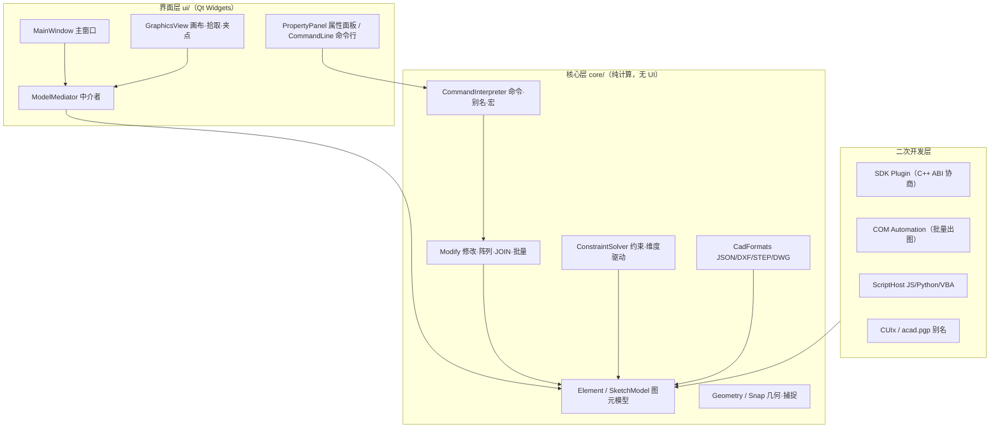

# SketchCAD

> 面向**航空与机械工程**的二维 CAD 绘图系统 —— 基于 **C++17 / Qt 6 Widgets** 构建，  
> 集参数化图元绘制、几何约束、公差标注、参数化三视图模板、批量编辑、GB/T 14665 黑白出图、  
> 跨格式互操作与完整二次开发体系于一体的桌面 CAD 平台。


目标】图层从"快照式分组"升级为主流动态语义，支撑大图治理与外来图纸语义还原。 【范围】1) ByLayer：Element 增加 byLayer 标志（默认新图元开），渲染/打印期动态解析层属性 （快照值作为 override 保留，属性面板单改图元自动转为 override）；2) 冻结 frozen/ 打印开关 plot/透明度 alpha 字段入 Layer（只增不改），冻结层不参与命中/重算/打印； 3) LTSCALE 全局线型比例（随图存档，命令 ltscale + 状态栏入口）；4) LAYISO/LAYUNISO/ LAYMCH 三条高频治理命令。 【约束】Layer 结构字段只增不改；旧档读入时 byLayer=false+快照=现值（行为完全向后兼容）； visible 烧进图元的历史行为保留（frozen 独立于 visible，二者叠加语义文档化）； GB/T 14665 标准层模板不动。 【验收】旧档逐字节语义兼容断言；冻结层图元 hitTest 零命中+打印零输出；ByLayer 改层色全层 实时联动断言；LTSCALE 0.5/2.0 下虚线段长比例断言；自测新增 ≥15 断言；零警告。


---

## 1. 作品预览

真实程序界面与由模板生成器经同一渲染链（模板 → `SketchModel` → `PrintEngine`）产出的工程图：

| 主界面（工具条 / 参数输入条 / 属性面板） | 户型平面图（交互实战） |
| ----------------------- | ----------- |
| 主界面                     | 户型平面        |

| 法兰盘三面图 | 箱体三视图（含剖视） | 轴承座三面图 |
| ------ | ---------- | ------ |
| 法兰盘    | 箱体         | 轴承座    |

| 飞机三面图 | 户型平面图（纯图纸渲染） | 法兰轮毂零件图 |
| ----- | ------------ | ------- |
| 飞机    | 户型           | 法兰轮毂    |

**黑白出图对比**（GB/T 14665 线宽分组映射 vs 直接彩色打印）——右侧为套用样式表后的结果，  
四类线型纯靠线宽即可在黑白介质上清晰区分：

| 不带样式表（彩色线宽图直接打印） | 套用 GB 黑白样式表 |
| ---------------- | ----------- |
| 无样式              | 有样式         |

---

## 2. 目录

- [1. 作品预览](#1-作品预览)
- [2. 目录](#2-目录)
- [3. 项目定位](#3-项目定位)
- [4. 核心特性](#4-核心特性)
- [5. 软件架构](#5-软件架构)
- [6. 快速上手](#6-快速上手)
- [7. 命令行速查](#7-命令行速查)
- [8. 参数化模板](#8-参数化模板)
- [9. 批量编辑三件套](#9-批量编辑三件套)
- [10. 打印与出图](#10-打印与出图)
- [11. 二次开发体系](#11-二次开发体系)
- [12. 测试与质量](#12-测试与质量)
- [13. 构建与开发目标](#13-构建与开发目标)
- [14. 目录结构](#14-目录结构)
- [15. 设计规范遵循](#15-设计规范遵循)
- [16. 设计文档导航](#16-设计文档导航)
- [17. 已知限制](#17-已知限制)

---

## 3. 项目定位

SketchCAD 不是又一个「演示级」的画图板，而是围绕**工程制图的真实工作流**设计的 CAD 内核：

- **参数化建模**：每个图元携带可编辑的几何与样式参数，修改即联动（约束求解、标注跟随）；
- **工程模板**：法兰盘 / 箱体 / 轴承座 / 法兰轮毂 / 飞机三面图 / 户型平面图等模板，  
  照 GB 附图尺寸一键生成符合投影关系（长对正·高平齐·宽相等）的三视图；
- **批量产能**：JOIN 连合、矩形/环形/路径阵列、剪贴板族，把「导入修复 → 批量布置 → 图间搬运」串成闭环；
- **出图合规**：按 GB/T 14665 的线型/线宽/图幅体系做黑白出图映射，满足图纸归档要求；
- **可扩展**：SDK 插件（C++ ABI 协商）、COM 自动化（Windows 批量出图）、脚本宿主（JS/Python/VBA）、  
  动作宏 / SCR、CUIx 界面定制、acad.pgp 命令别名 —— 一等公民级的二次开发面。

技术栈追求**零外部依赖、跨构建稳定**：核心层 `core/` 纯计算无 UI，界面层 `ui/` 经中介者模式与模型解耦。

---

## 4. 核心特性

### 4.1 绘图图元

| 类别  | 能力                                                                           |
| --- | ---------------------------------------------------------------------------- |
| 直线  | 两点 / 水平 / 垂直 / 定角 / 平行线（过点）/ 角平分线 / 与圆相切 / 正交 / 相对角度                         |
| 圆   | 圆心半径 / 圆心+圆周点 / 两点 / 三点外接 / 公切线内切 / 同心                                       |
| 圆弧  | 三点 / 起点-端点-半径 / 起点-端点-圆心 / 相切过渡                                              |
| 多边形 | 正多边形（内切 / 外接 / 边定）                                                           |
| 样条  | 自由 Catmull-Rom / 抛物线 / 双曲线 / 焦点准线 / 通过多点（含 4 点、焦点-准线变体）                      |
| 椭圆  | 轴定 / 焦点 / 三点 / 四点 / 内切                                                       |
| 其他  | 点、构造线 XLINE、射线 RAY、多行文字 MTEXT、单行文字 TEXT、表格 TABLE、边界 BOUNDARY/REGION、填充 HATCH |

### 4.2 制图要素

- **尺寸标注**：距离 / 半径 / 直径 / 对齐标注，自适应线·圆·弧；支持尺寸公差（`⌀60H8`、`20±0.2`）；
- **引线标注** 与**粗糙度符号** `SurfaceRoughness`、**剖切符号** `SectionCutSymbol`；
- **图框与标题栏**：标准幅面（A0–A5）+ 可填写标题栏；**剖视图**截面按 GB/T 4457.5 材料 19 值填充；
- **中心线 / 对称线 / 断裂线** 等制图辅助线型（GB/T 4457.4 线素体系）。

### 4.3 几何约束与参数化

- 隐式自动约束（相切 / 垂直 / 平行 / 同心）与显式声明约束；
- **约束可视化**：约束图标 + 类型标注 + 过约束 / 冲突高亮；
- **维度驱动**：尺寸即参数，修改标注数值经雅可比数值求解器驱动关联几何；
- **OSNAP 增强**：垂足 / 切点视觉标签与命中提示。

### 4.4 选择与编辑

- 选择系统：单击 / 框选 / 窗交 / **栏选（Fence）/ 多边形（WP·CP）/ 选择循环**；
- **快速选择 QSELECT**：按类型·图层·颜色·线型四维过滤（命令行 `qselect type=直线 layer=0`）；
- **夹点编辑** `GripOps`：Move / Rotate / Scale / Mirror / Stretch，双段确认交互；
- 修改命令：`move copy rotate scale mirror offset trim fillet chamfer explode align stretch lengthen break divide revert`。

### 4.5 查询与测量

`dist` 距离 / `area` 面积 / `massprop` 质量特性 / `id` 拾取查询 / `list` 图元详单（圆解析、椭圆 Ramanujan 近似、多边形 shoelace）。

### 4.6 图层与块

- **图层管理**：创建 / 切换 / 颜色 / 冻结 / 锁定，符合 GB/T 14665 标准图层模板；
- **块系统**：`block`（定义 / 插入 / 重定义 / 分解 / 删除 / 改名）、属性块 `attdef/attedit`、动态块 `dynset/dynlist`。

### 4.7 格式互操作

| 格式   | 方向    | 说明                                                                                                 |
| ---- | ----- | -------------------------------------------------------------------------------------------------- |
| JSON | 读 / 写 | 原生存档（向后兼容容缺 key）                                                                                   |
| DXF  | 读 / 写 | 导入 16 类实体（INSERT/ELLIPSE/SPLINE/DIMENSION/HATCH/POINT/LEADER/XLINE/RAY/ATTRIB/LTYPE 等），复杂实体降级不中断整档 |
| STEP | 读 / 写 | 工程数据交换                                                                                             |
| DWG  | 读 / 写 | 自研原生 R12 二进制（AC1009 三铁律）                                                                           |

### 4.8 输入约束与捕捉

- 正交 `ORTHO` / 栅格吸附 `SNAP`（F8 / F9）+ 状态栏同步；
- **对象捕捉**：端点 / 中点 / 圆心 / 象限点 / 垂足 / 切点，带命中标签；
- **追踪**：极轴 `POLAR` / 对象捕捉追踪 `OTRACK` / 临时追踪点 `TK`。

---

## 5. 软件架构



设计原则：**一切修改 = `std::vector<Change>` 纯函数产出，落盘由 `beginEdit` + `applyChanges` 单步撤销完成**。  
命令、GUI、模板、批量工具都只是这条流水线的不同「组装方式」，因此天然获得单步撤销与无头可测性。

---

## 6. 快速上手

### 环境要求

- **Qt 6.10.1 MinGW 64 位** + **MinGW-w64 GCC 13.1.0**（`mingw1310_64`）
- **CMake ≥ 3.16** 与 **Ninja**
- Windows（COM 自动化与 `windeployqt` 面向 Windows；核心层可在任意平台构建）

### 构建与运行

```bash
# 一键增量构建（Git Bash）
./build.sh                  # → build/SketchCAD.exe
./build.sh test             # 构建并运行核心自测（403/0）
./build.sh dist             # 用 windeployqt 打包独立运行的 dist/

# 手动 CMake
cmake -S . -B build -G Ninja -DCMAKE_BUILD_TYPE=Release
cmake --build build
./build/SketchCAD.exe
```

### 基本用法

1. 顶部菜单 **【绘图】** 或工具栏选择图元工具；
2. 跟随状态栏 / 命令行引导逐点输入，长度 / 角度可在**参数输入条**键入后回车；
3. 靠近已有图元端点 / 中点 / 圆心 / 象限点会自动吸附（智能捕捉）；
4. 选中图元在**属性面板**改参数，关联图元按约束自动跟随；
5. 右键拖拽平移，滚轮缩放；多级撤销 / 重做随时可用。

---

## 7. 命令行速查

底部命令行支持精确命令与前缀分派（Tab 补全子模式）。常用命令：

| 类别      | 命令                                                                                                                                      |
| ------- | --------------------------------------------------------------------------------------------------------------------------------------- |
| 绘图      | `line` `circle` `circle3p` `arc` `rect` `poly` `spline` `ellipse` `point` `xline` `ray` `mtext` `text` `table`                          |
| 修改      | `move` `rotate` `scale` `mirror` `offset` `trim` `fillet` `chamfer` `explode` `align` `stretch` `lengthen` `break_at` `divide` `revert` |
| 批量编辑    | `join` `arrayrect` `arraypolar` `arraypath`                                                                                             |
| 查询测量    | `dist` `area` `massprop` `id` `list`                                                                                                    |
| 选择与过滤   | `select_all` `invert` `select_layer` `qselect`                                                                                          |
| 图层 / 块  | `layer` `block` `attdef` `attedit` `dynset`                                                                                             |
| 剪贴板     | `copyclip` `copybase` `pasteclip` `pasteblock`                                                                                          |
| 标注 / 约束 | `dim` `dims` `constraint` `perp` `tangent2` `qconnect`                                                                                  |
| 输入约束    | `ortho` `snap` `dyn` `polar` `otrack` `tk` `tkclear`                                                                                    |
| 模板      | `aircraft_views`                                                                                                                        |
| 视图      | `zoom` `plane` `grid`                                                                                                                   |
| 宏 / 脚本  | `macrorec` `macrostop` `macrosave` `macroshow` `macroplay` `scr`                                                                        |
| 通用      | `undo` `redo` `clear` `help`                                                                                                            |

示例：

```
line 0,0 50,0                 # 直线 (0,0)→(50,0)
line_h 0,0 80                # 水平直线
circle_cr 20,20 10          # 圆心半径圆
arrayrect 3 4 20 15         # 3 行 4 列、行距20/列距15 矩形阵列
join                          # 连合选中同层 Line/Arc
qselect type=直线 layer=0    # 快速选择：类型=直线 且 图层=0
```

---

## 8. 参数化模板

照 GB 附图尺寸一键生成符合投影关系的三视图，参数可经命令 / 对话框联动收敛到合法值（`makeValid`）。

| 模板      | 入口               | 说明                        |
| ------- | ---------------- | ------------------------- |
| 法兰盘三面图  | `FlangeViews`    | 带颈平焊 / 平板止口法兰，螺栓孔分布圆、公差标注 |
| 箱体三视图   | `HousingViews`   | 圆筒形箱壁 + 剖视，GB 材料剖面线       |
| 轴承座三面图  | `BearingViews`   | 标准轴承座，主/俯/左三视图            |
| 法兰轮毂零件图 | `FlangeHubViews` | 法兰 + 轮毂组合零件图              |
| 飞机三面图   | `aircraft_views` | 机身/翼展按比例的正面·侧面·俯视三视图      |
| 户型平面图   | `FloorPlanViews` | 房间轴线尺寸、门窗、面积标注，参数化布局      |

---

## 9. 批量编辑三件套

导入修复 → 批量布置 → 图间搬运 的完整产能：

- **JOIN（连合）**：同层 Line/Arc 按端点容差链式连合为 Polyline；Arc 按弧长离散并入、接缝吸附消缝、  
  跨层不连；GUI 菜单传视图捕捉容差 `worldTol()`，命令行用固定 `kJoinDefaultTol=0.5mm`；
- **阵列**：`arrayrect` / `arraypolar` / `arraypath`，统一「P0 跳过」基点语义；路径阵列支持  
  **Measure（定距）/ Divide（均分）** 双语义；
- **剪贴板族**：`copyclip` / `copybase` / `pasteclip` / `pasteblock`，基于**版本化 JSON 载荷**  
  （自定义 mime，跨实例系统剪贴板搬运），粘贴为独立图元或整块引用，块依赖自动改名同步。

所有三件套命令走 `Change + applyChanges` 单步撤销，失败自动回滚空转快照。详见  
[`docs/batch-edit-join-array-clipboard-design-analysis.md`](docs/batch-edit-join-array-clipboard-design-analysis.md)。

---

## 10. 打印与出图

- `PrintEngine` 统一渲染链，支持 PDF / 位图 / 批量出图；
- **打印样式映射**（GB/T 14665）：按颜色·图层·**线型**三维匹配，黑白介质下强制线宽分组（粗实/细实/虚线/点画线），  
  支持简化 CTB 导入与 GB 预设；
- **COM 批量出图**：`SketchCAD.Automation` 无头驱动多图批量打印（与渲染链解耦）。

---

## 11. 二次开发体系

| 能力        | 形态                           | 说明                                                                              |
| --------- | ---------------------------- | ------------------------------------------------------------------------------- |
| SDK 插件    | C++ 头契约 + ABI 协商             | `IPlugin/IModel/IApplication`，`PluginManager` 运行时加载；ABI 区间 `[最小兼容, 当前]` 拒绝过新/过旧 |
| COM 自动化   | Windows IDispatch            | ProgID `SketchCAD.Automation`，批量出图引擎（headless）                                  |
| 脚本宿主      | QJSEngine（默认）/ CPython / VBA | `ScriptApi` 统一桥，菜单「脚本」                                                          |
| 动作宏 / SCR | MacroRecorder + ScriptRunner | `macrorec/macrosave/macroplay/scr`                                              |
| 界面定制      | CUIx + 命令别名                  | 工具条 / 工作空间；`acad.pgp` 兼容别名（`aliasreload` 重载）                                    |

---

## 12. 测试与质量

| 指标                     | 现状                                                                                 |
| ---------------------- | ---------------------------------------------------------------------------------- |
| 核心自测 `SketchSelfTest`  | **403 / 0 全绿**（非渲染断言，含约束每类 ≥1 用例 / 捕捉 / 格式往返 / 批量编辑 59 条）                          |
| GUI 回归                 | offscreen 构造主窗口，验证菜单结构 / 工具栏布局 / 选中交互 / 渲染级                                        |
| 性能基准 `SketchBenchmark` | 1万 打开 44.5ms·拾取 p99 0.011ms·**42.8×**；5万 打开 227ms·p99 0.063ms·**135.3×**（均匀网格空间索引） |
| 编译质量                   | `-Wall -Wextra` **零警告**；`build.sh test` 退出码 **0**                                  |

回归覆盖：约束求解、OSNAP、DXF 导入（含第三方样本）、DWG R12 往返、打印样式映射、批量编辑、  
空间索引增量渲染等 —— 全部纳入 `SketchSelfTest` 单一无头可执行，便于 CI。

---

## 13. 构建与开发目标

| CMake 目标           | 说明                              |
| ------------------ | ------------------------------- |
| `SketchCAD`        | 主程序可执行                          |
| `SketchSelfTest`   | 核心层无界面自测（403 断言）                |
| `SketchBenchmark`  | 空间索引 / 增量同步性能基准（带 QApplication） |
| `PlotStyleSamples` | GB 黑白打印样张生成 + 双路回归比对            |
| `ReadmeShots`      | 本文档配图生成（模板真实渲染 PNG）             |

```bash
cmake --build build --target SketchCAD          # 主程序
cmake --build build --target SketchSelfTest    # 自测
./build/SketchSelfTest.exe                     # 运行自测（退出码 0 = 通过）
```

---

## 14. 目录结构

```
sketch-cad-cpp/
├── CMakeLists.txt          # 全部目标（主程序 + 各 bench/测试）
├── build.sh                # 一键构建 / 测试 / 打包脚本（Git Bash）
├── src/
│   ├── main.cpp            # 程序入口
│   ├── core/               # 核心层：图元/几何/命令/捕捉/约束/格式（无 UI）
│   │   ├── Element*.cpp · SketchModel.*     # 图元模型与工厂
│   │   ├── LineModes · CircleModes · ArcModes · PolyModes · SplineModes · EllipseModes
│   │   ├── ConstraintSolver · Snap · Modify · Trim · Geometry
│   │   ├── CommandInterpreter · ToolRegistry · AliasTable · CuiManager
│   │   ├── CadFormats                      # JSON/DXF/STEP/DWG
│   │   ├── FlangeViews · HousingViews · BearingViews · FlangeHubViews
│   │   ├── FloorPlanViews · AircraftViews  # 参数化模板
│   │   └── Clipboard · Block · Layer · Constraint* · Inquiry · Boundary
│   └── ui/
│       ├── MainWindow · GraphicsView · ModelMediator
│       ├── tools/  · CommandLine · PropertyPanel · BomTree · RulerWidget
│       ├── PrintEngine · PlotRenderer · PrintSettings
│       └── PlotStyle · ScriptHost · com/（COM 自动化）
├── tests/SketchSelfTest.cpp  # 403 断言回归
├── bench/                    # PlotStyleSamples / SketchBenchmark / ReadmeShots
├── docs/                    # 设计文档 + 配图（docs/images/）
├── dist/                    # windeployqt 打包后的独立运行目录
└── tools/                   # 辅助脚本（如第三方 DXF 互操作样例生成）
```


```

---

## 15. 设计规范遵循

- **GB/T 14665-2012** 电气/机械制图：线型 9 类、线宽组（G3）、标准图层模板、字高下限 3.5mm；
- **GB/T 4458.4-2003** 尺寸标注几何生成器；
- **GB/T 4457.4 / 4457.5** 线素长度、剖面符号与材料填充；
- **GB/T 14689** 图幅与标题栏（A0–A5、装订边、标题栏避让）；
- **AC1009（R12）** DWG 三铁律：CODEPAGE、组码无换行、POLYLINE/VERTEX/SEQEND。

---

## 16. 设计文档导航

`docs/` 收录各模块的设计深思与重构记录（节选）：

- 用户手册：[`用户手册.md`](docs/用户手册.md)
- 批量编辑三件套：[`batch-edit-join-array-clipboard-design-analysis.md`](docs/batch-edit-join-array-clipboard-design-analysis.md)
- 内核与绘图：polyline-edit / grip-selection / boundary-region / inquiry-measure / chamfer-fillet
- 互操作：dxf-import-expansion / dxf-native-export / dwg-native-r12-design-analysis
- 打印出图：print-module / print-fidelity-fix / plot-style-mapping-design-analysis
- 二次开发：sdk-plugin-framework / com-automation / script-host / macro-script / cui-alias
- 选择系统：selection-group-qselect-filter-design-analysis

---

## 17. 已知限制

- 工具链路径在 `CMakeLists.txt` / `build.sh` 中写死为 `C:/Qt/6.10.1` 与 `C:/Qt/Tools` 默认安装位，
  换机 / 换版本需先调整路径常量；
- 路径阵列当前仅**平移**不旋转（AutoCAD 的「沿路径切线对齐项目」未实现）；
- 路径阵列的「闭合链」（首尾相接成环）暂以开放 Polyline 产出，后续可升级为 closed 以支持 hatch 边界；
- COM 自动化与 `dist/` 打包面向 Windows。

---

<p align="center">
<em>SketchCAD —— 让工程制图从「手动画线」走向「参数驱动 · 批量产能 · 合规出图」。</em>
</p>
