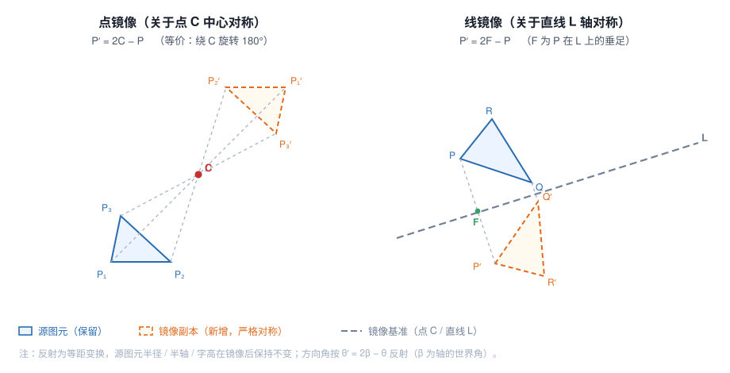

# 图元镜像功能 —— 算法、数学推导与实现分析

> 模块：`SketchCAD`（C++17 / Qt 6，namespace `SketchCAD`）
> 涉及文件：`src/core/Modify.{h,cpp}`、`src/core/Commands.cpp`、`src/ui/MainWindow.{h,cpp}`、`src/ui/GraphicsView.{h,cpp}`、`tests/selftest.cpp`
> 交互入口：菜单【编辑 ▸ 修改 ▸ 镜像…】、工具条「修改 ▸ 镜像」、命令 `mirror`
> 审阅对象：本文档对应的实现已通过 `SketchSelfTest`（727 断言全绿）、`ModifyMenuTest`、`ViewFitZoomTest`、`SelectWindowTest` 与 `SketchCAD` 主程序构建。

---

## 1. 需求与目标

> 优化现有程序，新增对已选图元的镜像功能。用户选中图元后点击「镜像」，程序提示选择镜像基准，支持两种方式——**指定一个点（点镜像）**或**一条直线（线镜像）**；确认后自动生成镜像图元，使其与源图元关于该点或直线**严格成对称关系**，并**保留图元原有属性**。要求正确计算对称变换，妥善处理各类图元的几何特征与边界情况。

拆解为四条可验证目标：

| 编号 | 目标 | 验收判据 |
| --- | --- | --- |
| G1 | 支持**点镜像**（关于一个点） | 对任意图元的每个控制点 `P`，镜像点 `P′ = 2C − P` |
| G2 | 支持**线镜像**（关于一条直线） | 对任意控制点 `P`，镜像点 `P′` 为 `P` 关于该直线的镜像 |
| G3 | 生成**新**镜像图元并**保留属性** | 源图元不变；新增副本继承图层/颜色/线宽/线型/文本等 |
| G4 | 正确覆盖各类图元的几何特征 | 圆弧起止角、椭圆长轴角、剖面线方向角、内孔点列均正确镜像 |

「严格成对称关系」是核心约束：**不是**视觉近似，而是逐点满足反射定义的精确几何关系。这直接决定了方向角类字段必须按反射公式修正，而不是沿用旧实现的「近似即可」。

---

## 2. 坐标与角度约定（推导的前提）

理解本项目角度语义是推导正确公式的前提，先把约定钉死：

- **世界坐标系**：标准笛卡尔右手系，`X` 向右为正、`Y` 向上为正（见 `Element.h` 注释）。模型层不感知屏幕方向。
- **视图映射**：视图层把世界坐标 Y 翻转后映射到 Qt 屏幕坐标（屏幕 `y` 向下）。
- **角度字段为「世界角」**：`Element::startAngle / endAngle / rotation` 存的是**世界坐标系下的 CCW 正角**（度）。证据来自既有实现：
  - `makePolarArray` 把元素绕中心旋转 `ang`（世界 CCW）后，对圆弧执行 `startAngle += ang; endAngle += ang`，对椭圆执行 `rotation += ang`；
  - `makeRotate` 对椭圆执行 `rotation += angleDeg`。
  只有当字段是世界角时，「世界 CCW 旋转 `ang`」才恰好等于「字段 `+ang`」。
- **渲染端取反**：`GraphicsView` 画圆弧时 `arcTo(rect, -startAngle, -(endAngle-startAngle))`，即屏幕角 = 世界角的相反数；椭圆用屏幕空间 `rotate(rotation)`。二者互为一致的 Y 翻转表达。

**关键推论**：镜像轴（由用户在画布上点选的两点给出世界坐标）与待修正的角度字段**处于同一世界系**，因此可以直接在世界系里做反射运算；Y 翻转只是渲染期的仿射变换，不会改变「世界角」的正确性（详见 §4.5）。

---

## 3. 现状调研：旧 `makeMirror` 的缺陷

旧实现签名 `makeMirror(src, int axis, axisP1, axisP2)`，`axis∈{0,1,2}`，存在四类问题：

1. **只有「水平/竖直/自定义直线」三态，没有点镜像**（G1 无法满足）。
2. **水平/竖直轴取自图元控制点的算术平均**（`yMid = Σy/n`），而非用户指定，语义含糊；且对多图元选择，各自按自身均值取轴，整体并不关于同一条轴镜像。
3. **圆弧起止角完全未修正**，源码注释直言「按视觉近似即可」——违反「严格对称」（G4）。
4. **椭圆只做 `rotation = -rotation`**：该式仅对「水平轴」正确；对竖直轴应为 `180° − rotation`，对任意斜轴更是错的；Hatch / Text / Dimension 的方向角与内孔点列完全未处理。

此外旧实现是**原地替换**（`e.id = s.id` → update），而需求要求「**生成**镜像图元」（G3），语义上应为新增副本。

因此，本次是**重写**而非修补。

---

## 4. 数学推导

设镜像变换为 `R: ℝ² → ℝ²`。反射（点反射、线反射）都是**等距变换（isometry）**且是**对合**（`R² = I`）。

### 4.1 点对称（中心对称）

关于点 `C = (Cx, Cy)` 的中心对称定义为将每点映到「以 `C` 为中点」的对应点：

```
P′ = 2C − P
```

写成相对 `C` 的形式即可看出本质：令 `v = P − C`，则

```
P′ − C = (2C − P) − C = C − P = −(P − C) = −v
```

即 `v ↦ −v`。这正是**绕 `C` 旋转 180°** 的线性部分（旋转 180° 的矩阵是 `[[−1,0],[0,−1]]`）。因此：**点镜像 ≡ 绕镜像中心旋转 180°**。这条等价关系非常有用——它把「点镜像」归约到「已知正确的旋转」，从而方向角类字段可套用旋转规则。

对方向角：绕 `C` 旋转 180° 后，任何方向的世界角

```
θ′ = θ + 180°   （模 360°）
```

### 4.2 轴对称（线对称）

设镜像轴为直线 `L`，过点 `p1`、方向 `d = p2 − p1`（非零）。把 `P` 相对 `p1` 分解到轴的切向 `u = d/|d|` 与法向 `n = u⊥`：

```
P − p1 = t·u + s·n,   t = (P − p1)·u,   s = (P − p1)·n
```

轴对称的几何定义是「**保切向、反法向**」：`t` 不变、`s` 取反。于是

```
P′ − p1 = t·u − s·n
```

等价地用「垂足公式」表达更便于实现。`P` 在 `L` 上的垂足为 `F = p1 + t·(p2−p1)/|p2−p1|`，而 `P′ = 2F − P`。代码 `mirrorPtAcrossLine` 正是这一形式（用未单位化的 `d` 代 `u`，令 `t = ((P−p1)·d)/|d|²`，`F = p1 + t·d`，`P′ = 2F − P`）；二者代数等价，且避免了显式开方与单位化带来的精度损失。

退化情形：`|d|² < 1e-18`（两点重合，轴未定义）时返回原点不变，作为防御。

### 4.3 方向角的反射公式 `θ′ = 2β − θ`

设镜像轴 `L` 的世界角为 `β = atan2(p2y−p1y, p2x−p1x)`。对任一单位方向 `u(θ) = (cosθ, sinθ)`，其关于 `L` 的像的方向角满足：

```
θ′ = 2β − θ
```

**证明（旋转—反射—旋转三步）**：

1. 把 `L` 旋转 `−β`，使它与 `X` 轴重合。此时考察方向角变为 `θ − β`。
2. 关于 `X` 轴反射（保 x、反 y），方向角 `φ ↦ −φ`，得 `−(θ − β) = β − θ`。
3. 再旋转 `+β` 转回，得 `β + (β − θ) = 2β − θ`。

故 `θ′ = 2β − θ`。∎

该公式对 `L` 过不过原点都成立（方向角与平移无关）。

### 4.4 圆弧为什么「两端分别映射」就够（集合级证明）

对圆弧，我们把 `startAngle`、`endAngle` **分别**按 §4.3/§4.1 映射，并不交换二者。需要证明这样渲染出的弧恰好是源弧的镜像。

渲染器对圆弧的绘制等价于：在屏幕角意义下从 `−start` 扫掠到 `−end`，即沿弧取遍世界角区间 `[start, end]` 上线性插值的全部角度：

```
S = { start + t·(end − start) : t ∈ [0,1] } = 区间 [start, end]
```

镜像后取 `start′ = 2β − start`、`end′ = 2β − end`，渲染器取遍

```
S′ = { start′ + t·(end′ − start′) : t ∈ [0,1] }
   = { (2β − start) + t·((2β − end) − (2β − start)) }
   = { 2β − (start + t·(end − start)) }
   = { 2β − θ : θ ∈ S }
```

即**恰好是源弧的世界角集合经 `θ ↦ 2β − θ` 的像集**。而反射把源弧的每一点按同一公式映射，故像集 = 源弧的镜像。∎

顺带说明：反射反定向，故参数扫描方向在几何上自然反向；但由于我们映射的是**角度区间集合**而非「起点/终点语义」，这一反向被公式自动吸收，无需交换起止角，也无需调整渲染。这正是「两端分别映射」正确、且**优于**「交换 + 归一化」的原因。

点对称同理：`start′ = start + 180`、`end′ = end + 180`，得到的角度区间 `[start+180, end+180]` 正是旋转 180° 的像集。

### 4.5 Y 翻转是否影响公式？

**不影响。** 论证分两步：

- **点位置**：`mirrorPtAcrossLine` 与 `P′ = 2C − P` 都在世界系内完成；世界系是标准右手系，公式成立。
- **角度字段**：由 §2，`startAngle/endAngle/rotation` 均以世界角存储，渲染时才翻转到屏幕。镜像轴也以世界坐标给出。二者同系，故世界系里的 `θ′ = 2β − θ` 直接成立；Y 翻转是渲染期变换，对所有角度统一「取反」，会同时作用于「源角」与「像角」，在等式中约去（`−(2β − θ) = 2(−β) − (−θ)`，即屏幕系里也满足同样的反射式，只是轴角变为 `−β`）。

结论：只需在世界系里推导与实现，无需为屏幕方向做任何特判。此结论已由渲染类测试与离线断言共同验证。

### 4.6 点镜像的方向角：`+180°`

点镜像 = 绕 `C` 旋转 180°（§4.1），故对方向角类字段统一 `θ′ = θ + 180°`。注意这与「线镜像」不是同一公式：线镜像里 `β` 是轴角，点镜像里没有轴、等效 `β → ∞`，必须单独分支。

### 4.7 保距 ⇒ 不变量清单

反射是等距变换，**所有长度量在镜像后不变**。据此可直接判定哪些字段「照抄、不动」：

| 量 | 处理 | 理由 |
| --- | --- | --- |
| 圆 / 圆弧 `radius` | 不变 | 等距 ⇒ 半径不变 |
| 椭圆 `radius`、`radiusY` | 不变 | 半轴长度不变 |
| 文本 `radius`（字高复用） | 不变 | 字高是长度 |
| `lineWidth` / `layer` / `color` / `lineStyle` | 不变 | 非几何属性，原样继承 |

---

## 5. 分图元类型的处理策略

统一策略：**先复制源图元、逐点反射 `pts`（Hatch 另反射 `holes`）**，再**按类型修正方向角类字段**。折线/样条的弧段由三个相邻节点定心（`geo::arcThrough`），因此**反射控制点即反射整条弧**，无需单独处理角度——这是本项目数据模型带来的便利。

| 类型 | 几何字段 | 方向角修正 |
| --- | --- | --- |
| Line / Polyline / Spline / Rectangle / Polygon | `pts` | 无 |
| Circle | `pts[0]`（圆心） | 无（`radius` 不变） |
| Arc | `pts[0]`（圆心） | 点镜像：`start/end += 180`；线镜像：`start′=2β−start`、`end′=2β−end` |
| Ellipse | `pts[0]` | 点镜像：`rotation += 180`；线镜像：`rotation′ = 2β − rotation` |
| Hatch | `pts`（外边界）+ `holes`（内孔点列） | 同椭圆：`rotation` 按点 / 线规则反射 |
| Text | `pts`（锚点） | 无（轴对齐文本，字高不变） |
| Dimension | `pts[0]`、`pts[1]`（测量点） | 无（几何由 `dim::build` 从端点重建，反射端点即反射标注） |
| Constraint | `pts` | 无（`refA/refB` 引用关系不随几何自动重定向，见 §8） |

**矩形的一个已知限制**：本项目矩形由「两个对角点」表示且恒为轴对齐。关于**斜轴**镜像时，真实的镜像图形是「旋转后的矩形（平行四边形）」，而 `Rectangle` 类型无法表达；此时我们反射两个对角点（对**点镜像**与**轴对齐的线镜像**是精确的，对**斜轴**是包围盒意义下的近似）。该限制源于数据模型，见 §8。

---

## 6. 交互设计

### 6.1 流程

```
选中图元 → 【镜像】→ 选择基准方式
                         ├─ 点镜像 → 画布单击 1 点（对称中心）→ 生成镜像副本
                         └─ 线镜像 → 画布依次单击 2 点（定义镜像轴）→ 生成镜像副本
```

### 6.2 复用既有拾取基础设施（不新造轮子）

`GraphicsView` 早已具备「中心点拾取模式」：`setPointPickMode(true)` 后左键点击发出 `canvasPointPicked(x,y)`（世界坐标），且**每次拾取后模式仍保持开启**（见 `GraphicsView::mousePressEvent`）。环形阵列的「拾取中心点」即基于它。镜像直接复用：

- **点镜像**：进入拾取模式，第 1 次拾取即得到中心 `C`。
- **线镜像**：进入拾取模式，第 1 次拾取记 `p1` 并提示「请拾取第二点」；因模式未自动关闭，第 2 次拾取得到 `p2`，随即执行。

无需新增任何对话框类或 CMake 目标，把改动面收敛在既有文件中。

### 6.3 状态机

```
         ┌───────────── mirrorPending_ = true ──────────────┐
 [空闲] ─┤  mirrorIsPoint_ = true  → 拾取1点 → 执行 → 复位 │
         │  mirrorIsPoint_ = false → 拾取第1点(记mirrorP1_) │
         │                          → 拾取第2点  → 执行 → 复位│
         └────────────── Esc/右键 → 复位（取消）───────────┘
```

- 拾取回调 `onCanvasPointPicked` 中，**镜像状态优先于阵列对话框回填**（`if (mirrorPending_) { handleMirrorPick(p); return; }`），避免两条流程互相污染。
- **取消**：新增信号 `GraphicsView::pointPickCancelled()`，在 Esc 取消 `pointPickMode` 时发出，`MainWindow::onPointPickCancelled()` 复位镜像状态——修正了「Esc 后 `mirrorPending_` 悬挂、后续点击不再生效」的隐患。

### 6.4 生成与选中

执行后 `applyChanges` 返回新 ID 列表，随即 `setSelection(newIds)` 选中镜像副本，便于用户继续对该副本操作（延续本项目「阵列复制后选中副本」的既有习惯）。

---

## 7. 实现映射（函数 → 代码位置）

| 层 | 位置 | 职责 |
| --- | --- | --- |
| 数学原语 | `Modify.cpp: mirrorPtAcrossLine` | 线反射（垂足公式） |
| 核心 | `Modify.cpp: makeMirror(src, isPointMirror, base1, base2)` | 生成点/线镜像副本（唯一实现） |
| 声明 | `Modify.h` | `makeMirror` 新签名与语义注释 |
| 命令 | `Commands.cpp: "mirror"` | `mirror point x y` / `mirror line x1 y1 x2 y2` / `mirror h` / `mirror v` |
| 入口 | `MainWindow.cpp: mirror()` | 弹出「点镜像 / 线镜像」选择 |
| 拾取 | `MainWindow.cpp: handleMirrorPick()` | 收集基准点（点 1 个 / 线 2 个） |
| 落库 | `MainWindow.cpp: applyMirror()` | 调 `makeMirror` + `applyChanges` + 选中副本 |
| 复位 | `MainWindow.cpp: finishMirror()` / `onPointPickCancelled()` | 状态与光标复位 |
| 信号 | `GraphicsView.h/.cpp: pointPickCancelled` | Esc 取消通知 |
| 测试 | `tests/selftest.cpp` 20/20b–20f | 点/线镜像、圆弧/椭圆/剖面角、属性继承 |

**核心实现骨架**（`Modify.cpp`）：

```cpp
std::vector<Change> makeMirror(const std::vector<Element>& src,
                               bool isPointMirror, const Vec3& base1, const Vec3& base2) {
    std::vector<Change> out;
    const double dx = base2.x - base1.x, dy = base2.y - base1.y, L2 = dx*dx + dy*dy;
    const double beta = (L2 < 1e-18) ? 0.0 : std::atan2(dy, dx) * 180.0 / M_PI;  // 轴世界角
    for (const auto& s : src) {
        Element e = s; e.id = -1;                    // 新增副本，属性全部继承
        if (isPointMirror) for (auto& p : e.pts) p = Vec3(2*base1.x - p.x, 2*base1.y - p.y, 0);
        else               for (auto& p : e.pts) p = mirrorPtAcrossLine(p, base1, base2);
        if (e.type == ElementType::Hatch)            // 内孔点列同步反射
            for (auto& hole : e.holes)
                for (auto& p : hole)
                    p = isPointMirror ? Vec3(2*base1.x - p.x, 2*base1.y - p.y, 0)
                                      : mirrorPtAcrossLine(p, base1, base2);
        // 方向角：点镜像 +180；线镜像 2β−θ
        if (e.type == ElementType::Arc) {
            if (isPointMirror) { e.startAngle += 180.0; e.endAngle += 180.0; }
            else { e.startAngle = 2.0*beta - e.startAngle; e.endAngle = 2.0*beta - e.endAngle; }
        }
        if (e.type == ElementType::Ellipse || e.type == ElementType::Hatch)
            e.rotation = isPointMirror ? (e.rotation + 180.0) : (2.0*beta - e.rotation);
        out.push_back({ -1, e, false, isPointMirror ? QStringLiteral("点镜像") : QStringLiteral("线镜像") });
    }
    return out;
}
```

---

## 8. 边界情况与取舍

1. **镜像轴退化**（`p1 == p2`，`|d|² < 1e-18`）：轴未定义。`mirrorPtAcrossLine` 返回原点、`beta` 取 0，整体退化为恒等——不产生错误结果，也不崩。交互侧两点几乎重合时同理（视图坐标抖动不会引发异常）。
2. **空选择**：`mirror()` 与 `applyMirror()` 均先判空并写日志「请先选中要镜像的图元 / 无可镜像图元」，不进入拾取模式。
3. **矩形斜轴镜像**：见 §5 的限制说明。对点镜像与轴对齐线镜像精确；斜轴下两点反射后仍以轴对齐矩形呈现，属数据模型限制下的合理近似。
4. **约束（Constraint）**：`pts` 会被反射，但其引用的 `refA/refB` 指向原图元，不自动重定向到镜像副本。当前镜像对约束的语义有限，属已知留白（§9）。
5. **文本 / 标注**：按「严格几何对称」只反射锚点，**不把文字镜像成反字**。这是工程上的取舍：镜像后文字仍正向可读，符合制图习惯；若需「文字也镜像」可后续加选项。
6. **对合性**：对镜像副本**再做一次相同镜像**应回到源位置。这是反射的对合性质 `R² = I`，也是「严格对称」的天然自检（§9 建议补此回归）。
7. **旧接口变更**：`makeMirror` 由 `int axis` 三态改为 `bool isPointMirror + base1/base2`，同步更新了 `Commands.cpp`、`MainWindow.cpp` 两处调用与 `selftest.cpp` 直接 API 调用；未发现本仓库其他调用点。

---

## 9. 验证与测试

新增/调整的断言（`tests/selftest.cpp`，随 `SketchSelfTest` 运行）：

| 断言 | 覆盖 |
| --- | --- |
| 点镜像：生成新增副本（id=-1） | G3 新增语义 |
| 点镜像圆：圆心 (10,0) → (−10,0) | G1 |
| 点镜像圆：半径不变 (7) | §4.7 不变量 |
| 点镜像：图层/线型/颜色属性完整继承 | G3 属性保留 |
| 线镜像弧：起止角 30/120 → −30/−120（镜轴 x 轴，β=0） | §4.3 / §4.4 |
| 线镜像椭圆：长轴角 30 → 150（镜轴 y 轴，β=90） | §4.3（`2β−θ`） |
| 线镜像椭圆：半轴不变 | §4.7 |
| 点镜像椭圆：长轴角 30 → 210 | §4.6 |
| 线镜像剖面：边界与内孔 y 同步取反 | Hatch `holes` |
| 线镜像剖面：剖面线方向角 45 → −45 | Hatch `rotation` |
| （保留）`mirror h`：直线 y 坐标不变 | 既有命令回归 |

运行结果：

- `SketchSelfTest`：**727 通过 / 0 失败**；`mirror` 命令仍在 `CommandRegistry` 中（`16/16`）。
- `ModifyMenuTest`：`RESULT: PASS`（【修改】菜单结构/图标/工具条下拉含「镜像」均通过）。
- `ViewFitZoomTest` / `SelectWindowTest`：全部通过（`GraphicsView` 改动无回归）。
- `SketchCAD.exe`：编译链接成功。

> 说明：离屏（`QT_QPA_PLATFORM=offscreen`）下字体目录缺失导致文字不渲染，但几何断言全部可用，不影响上述结论。

### 手绘验证图（图示）



ASCII 速览：

```
   点镜像 (P′ = 2C − P)              线镜像 (P′ = 2F − P)
   P₁ ●        ● P₁′                P ●╲
       ╲      ╱                        ╲ ╲  F ●——— L
        ╲ C ╱                          ╲ ╲
         ╳                              ╲● P′
        ╱ ╲         P₃ ●─ ─ ─ ─ ─ ─ ─ ─ ─ ─● R
   P₃ ●   ● P₃′        （F 为 P 到 L 的垂足，PF = FP′）
```

---

## 10. 遗留与后续（可选增强）

1. **对合性回归**：补「镜像两次 == 恒等」的断言，作为「严格对称」的强校验。
2. **副本命名**：当前副本沿用源名称。可在副本名后追加「镜像」后缀以便 BOM/属性面板区分。
3. **可镜像文本选项**：提供「文字保持正向 / 文字一并镜像」开关。
4. **斜轴下的矩形/约束重定向**：若要严格支持斜轴矩形，需引入「旋转矩形」表示或将斜轴结果自动 `explode` 为四条边；约束则需在建副本时把 `refA/refB` 重定向到对应镜像副本。
5. **对称中心/轴的输入方式**：除画布拾取外，可增加「输入坐标」以支持精确作图（当前命令 `mirror point/line` 已支持坐标输入）。
6. **方向角归一化**：字段当前不做 `mod 360`，数值可能累计（如 `2β−θ` 超出 ±360）。渲染不受影响，但若需展示可用 `normalizeAngle` 归一到 `(−180,180]`。
